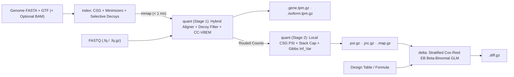

# Langur: Fast, Statistically Calibrated Splice-Graph Quantification and Differential Splicing in Rust

*CLI binary: `langur` · Index format: `.lidx`*

---

## Abstract

Alignment-free quantification on **Contiguous Splice Graphs (CSGs)**, pioneered by Whippet (Sterne-Weiler et al., *Molecular Cell* 2018), profiles both binary ($K_1$) and complex ($K_n \ge 2$) alternative splicing directly from FASTQ files without genome alignment or BAM generation. However, scaling legacy CSG implementations to modern human cohorts exposes four bottlenecks: ungapped matching drops reads near indels and splice-proximal SNPs; transcriptome-only indexing allows diverged pseudogene and intronic reads to force-map onto parent genes; per-gene EM and naive Beta variance understate paralog and multi-path ambiguity; and two-group pooled Beta Monte Carlo testing (`whippet-delta`) cannot adjust for covariates and suffers severe false-discovery inflation under biological overdispersion.

**Langur** is a ground-up Rust re-architecture (`index`, `inspect`, `quant`, `delta`) combining a zero-copy `mmap` splice-graph + selective genomic decoy index (`< 1 ms` load), hybrid ungapped + zero-allocation banded Gotoh spliced alignment with 1-SNP junction tolerance, joint Connected-Component Variational Bayes EM (`CC-VBEM`) with unified 5'-hexamer/GC bias correction, targeted collapsed Gibbs inferential variance (`Inf_Var`), and a covariate-aware Beta-Binomial GLM (`delta`) with Spliced vs. Tandem UTR stratified Cox–Reid Empirical Bayes dispersion shrinkage. On the 480M-read human `E-MTAB-3766` cohort (GRCh37.71, 6-way fresh 2026 arm64 runs, 16 threads, `--biascorrect`), Langur finishes end-to-end in **4m 26s (`266.0 s`: `14.6 s` index, `248.9 s` 6-sample `quant` at `1.42 GB` RAM, `2.50 s` `delta` at `191 MB`)**—**37.7×** faster than `Whippet.jl`, **1.82×** faster and **6.9×** less RAM than `Whippet2-turbo`, **2.5×** faster and **8.5×** less quant RAM than `Salmon 2.12.0 + SUPPA2 2.4`, and **7.6×–8.1×** faster with **21.9×** less RAM and zero BAMs (`65 GB` saved) than `STAR 2.7.11b + MAJIQ v3.0.25` and `STAR + rMATS-turbo v4.3.0`—while cutting gene/isoform MedARD **5.5× / 2.85×**, leading all BAM-free tools in differential splicing (`TPR = 0.338` at **2.0% realized FDR** spliced / `0.336` at **5.4% FDR** all; `0.567 / 0.565` AUPRC; **78–81% recall** on large isoform switches), slashing realized FDR **15×** vs. legacy Whippet (`81.5%`) and **36×** vs. `STAR + rMATS-turbo v4.3.0` (`72.0%` JC / `73.6%` JCEC), and delivering **10×** higher sensitivity than `MAJIQ v3 heterogen` (`0.034`) at `n = 3 vs 3`. On real human WTC11 RNA-seq (LRGASP `ENCSR673UKZ`, GRCh38 GENCODE v38, 60,649 genes, 91.6M reads), Langur builds the index in **14.8 s** (**46.2×–47.3×** faster and **28×** smaller than `STAR 2.7.11b` / `STAR + MAJIQ v3`) and quantifies WTC11 in **72.7 s** at **1.35 GB RAM** (**2.6×** faster and **9.1×** less RAM than Rust `Salmon 2.12.0 + SUPPA2 2.4`; **5.1×–7.24×** faster, **23.5×** less RAM, and zero BAMs vs. `STAR 2.7.11b + MAJIQ v3.0.25` and `STAR + rMATS-turbo v4.3.0`), sweeping **27/27** polymorphic CSG strata against matched PacBio HiFi Iso-Seq ($r = 0.9338$, $\text{MAE} = 0.0789$), matching `STAR + MAJIQ v3.0.25` head-to-head even on MAJIQ's own `12,899` annotated splice-junction LSV connections ($r = 0.9602$ vs. $0.9603$, $\text{MAE} = 0.0645$ vs. $0.0632$), beating `Salmon 2 + SUPPA2` across every stratum even on SUPPA2's own truth (binary $K_0/K_1$: $r = 0.9403$ vs. $0.7393$, **-53% MAE**), and outperforming `STAR + rMATS-turbo` on full-length complex ($K_n \ge 2$) exon inclusion ($r = 0.9551$ vs. $0.8863$, **-35% MAE**). On 14 real human CEU LCL donors from Geuvadis (`ERP001942`, 706.9M reads, GRCh38), Langur quantifies the cohort in **5m 47s (`347.3 s`, `2.03M reads/s`)** at **1.39 GB RAM** (**32.1×** faster and **4.5×** less RAM than original `Whippet.jl` v1.6.2, **1.24×** faster and **7.1×** less RAM than `Whippet2-turbo`, and **+43.8M** more mapped pairs than both), yields **0.2 mean / 0.0 median false positives** across all 10 exact 3v3 same-condition null splits (**7,545×** fewer than native `Whippet.jl` v1.6.2 `Prob ≥ 0.95` and **4×** fewer than `Whippet2-turbo`), and cuts residual spliced overdispersion **15.7%** while doubling `chrX`/`chrY` signal recovery under multivariable batch adjustment (`~ center + sex`) in **7.0 s** at **177 MB RAM**. Finally, on a real RF-stranded ENCODE `PTBP1` knockdown cohort (`K562`, `ENCSR527IVX` vs. `ENCSR129RWD`, 255.3M reads), Langur finishes in **2m 59s** at **1.18 GB RAM**, calling **58/58 Spliced hits** (`0` `TS`/`TE` noise) in **1.39 s** while recovering the `MAP4K4` 9 bp microexon (`#1` genome-wide) and the canonical `PTBP2` exon-10 NMD switch.

---

## 1. Motivation, Lineage & Scope

Bulk RNA-seq splicing studies typically trade off between two paradigms:
1. **Genome-aligned callers (`STAR` + `MAJIQ`, `rMATS`, `LeafCutter`):** Strong local junction accuracy and de novo discovery, at the cost of heavy genome indices (~30 GB), high RAM (>30 GB), large coordinate-sorted BAMs, and binary-only event definitions in `rMATS` (omitting `AF`/`AL`, complex $K_n \ge 2$ hubs, and expression TPMs).
2. **Alignment-free tools (`Whippet.jl`, `Salmon` + `SUPPA2`):** Eliminate BAM generation, but `SUPPA2` derives event PSI solely from full-length isoform TPMs—propagating isoform deconvolution error into local splice sites—while legacy `Whippet.jl` suffers from ungapped matching, pseudogene force-mapping, uncalibrated pooled Beta MC testing, and single-threaded Julia overhead.

**Attribution, Scope & Transparency:**
- **Attribution:** Langur is an independent Rust re-architecture building on the CSG representation and motif taxonomy introduced by Tim Sterne-Weiler and colleagues (*Molecular Cell*, 2018), alongside independent implementations of published statistical concepts from `Salmon` (selective decoys, VBEM, Gibbs uncertainty) and `edgeR`/`DESeq2` (Cox–Reid Empirical Bayes GLMs), plus overhang-diversity QC for PCR junction-stack artifacts highlighted in `MAJIQ`.
- **Scope:** Purpose-built for **bulk short-read RNA-seq** (paired-end or single-end Illumina), with optional BAM-derived novel splice-site import at index time (`index --bam`). For single-cell or full-length long-read (PacBio HiFi / ONT) isoform analysis, use dedicated frameworks such as **Isosceles** (Kabza, Sterne-Weiler et al., *Nature Communications* 2024), **Oarfish**, or **IsoQuant**.
- **License & Transparency:** MIT License. Developed iteratively with AI-assisted coding and review (Google Gemini), with every biological invariant and benchmark audited via automated unit, parity, and full-human test suites.

---

## 2. Pipeline Architecture

| Bottleneck | Legacy Whippet (`Whippet.jl` / `Whippet2`) | Langur (Rust) |
|---|---|---|
| **Index loading** | Full heap deserialization every run (`1.7–7.3 s`) | Zero-copy `mmap` binary file (`0.03–0.3 ms`) |
| **Pseudogene / intronic noise** | Transcriptome-only index | Selective genomic decoys with strict-inequality filter (`decoy > CSG`) |
| **Indels & boundary SNPs** | Ungapped matching only | Fast ungapped path + zero-alloc banded Gotoh X-drop + 1-SNP splice jumps |
| **Multi-gene ambiguity** | Equal pre-splitting across genes | Joint Connected-Component Variational Bayes EM across paralog families |
| **Complex $K_n \ge 2$ uncertainty** | Closed-form Beta variance only | Targeted collapsed Gibbs posterior variance (`Inf_Var`, col. 15 of `.psi.gz`) |
| **Differential splicing** | Pooled 2-group Beta MC (no covariates, high FDR) | Covariate-aware Beta-Binomial GLM with Spliced vs. Tandem UTR EB priors |
| **Reproducibility** | Minor MC/thread drift | 100% bit-for-bit identical across thread counts and `--batch` runs |

---

## 3. Zero-Copy Splice-Graph & Selective Decoy Index (`index`)

- **CSG & Motif Parity:** Partitions each gene's overlapping exons (plus optional `--bam` novel junctions) into minimal non-overlapping sub-intervals ordered $5' \to 3'$, preserving Whippet's canonical motifs (`CE`, `AA`, `AD`, `RI`, `AF`, `AL`, optional `BS`, and tandem UTRs `TS`/`TE`).
- **Exon + Junction-Bridge Minimizers:** Indexes canonical minimizers across both exonic nodes and exact sequence bridges spanning every annotated splice junction, enabling single-lookup splice jumping even across microexons.
- **Selective Genomic Decoys:** Following Salmon's selective alignment strategy (Srivastava et al., 2020), scans non-exonic intervals in parallel and retains only genomic windows sharing seeds with exons—capturing processed pseudogenes and paralogous repeats without indexing the full 3 Gb genome.
- **Instant `mmap` Loading:** Writes a 64-byte-aligned binary container mapped directly into virtual memory (`0.03–0.3 ms` load, shared zero-copy across `--batch` cohorts).

<b>Technical Details: Minimizer Table, Flank Encoding & Binary Format</b>

- **Minimizers:** Canonical odd-$k$ minimizers (default $k = 17$, window $w = 8$, invertible Wang64 hash) in a 2-level radix-bucketed open table (`MinBucketOffsets`, `MinKeyLo`, `MinSlots`, `MinPostings`) with inline single-hit fast-path slots (`MinimizerLookup::Inline`).
- **Annotated junction seeds:** Extracted from the $(k-1)+(k-1)$ sequence across every annotated splice edge `(src_node, dst_node)` with exact `left_overhang` $\in [1, k-1]$.
- **Precomputed node metadata:** 2-bit 16-bp acceptor/donor boundary flanks with explicit valid base counts (`0..=16`) for single-instruction XOR + popcount 1-SNP matching; canonical splice dinucleotide flags (`GT-AG`, `GC-AG`, `AT-AC`); cumulative transcript prefix lengths (`tx_node_prefix_len`) for $O(\log N_t)$ fragment-length queries; and 20-bin expected transcript GC profiles (`tx_expected_gc`).
- **Selective decoys:** Non-CSG hits expanded by `decoy_window_pad = 250 bp`, merged, split at `N`/IUPAC runs (preventing spurious poly-`A` runs in 2-bit encoding), and indexed with `max_decoy_occ = 32`.
- **Container:** 17 `#[repr(C)]` `bytemuck::Pod` sections aligned to 64-byte boundaries with magic header (`LANGUR01`) and `CRC32` checksum.

---

## 4. Hybrid Spliced Alignment & Decoy Screening (`quant` — Alignment)

- **Two-tier seeding & zero-allocation gapped recovery:** Reads with $\ge 2$ low-copy CSG minimizers ($\le 64$ postings) automatically skip repetitive Alu/poly-A postings (falling back to all postings for high-copy paralog families). Clean reads run a fast SIMD `memcmp` / ungapped scan; genuine small-indel mismatch clusters (complexity-guarded against homopolymer tails) invoke a zero-allocation stack-banded Gotoh affine-gap X-drop aligner (`HALF_BAND = 12`, `X_DROP = 24`), paired with exact score upper-bound candidate pruning.
- **Boundary-proximal SNPs & annotated-first splice jumping:** Retains near-optimal boundary extensions so SNPs 1–3 bp from donor/acceptor sites never block splice jumping; evaluates annotated junctions first with **zero splice penalty** (`min_anno_overhang = 4 bp`), falling back to 1-SNP-tolerant novel splice-flank matching (`min_novel_overhang = 8 bp`, prioritizing canonical `GT-AG`/`GC-AG`/`AT-AC`).
- **Strict-inequality pseudogene immunity:** Perfect CSG hits skip decoy alignment completely. On imperfect hits sharing decoy seeds, decoys are scored under the identical matrix; because annotated junctions incur zero penalty, an intronless processed pseudogene can at most *tie* spliced parent-gene mRNA. Langur filters a read as `DecoyFiltered` **only when** $S_{\text{decoy}} > S_{\text{CSG}}$—discarding diverged pseudogene/intronic reads while preserving true parent-gene reads on exact ties.
- **Strand-aware paired-end concordance:** Supports unstranded, FR (`--stranded`), and RF/TruSeq dUTP (`--stranded-reverse`) libraries with exact spliced transcriptomic fragment lengths across compatible isoforms.

<b>Technical Details: Scoring Matrix, Deferred Decoys & Streaming I/O</b>

- **Scoring:** Match `+2`, mismatch `-4`, `'N'` `-1`, gap open `-6`, gap extend `-1`; non-canonical novel splice penalty `-2`; optional `--circ` back-splices (`dst <= src`, `min_ov = 10 bp`); boundary extension retained within `12` points of prefix peak.
- **Deferred decoy seeding:** Primary seeding sets only `has_any_decoy_posting`; decoy seeds (bucketed by `(decoy_id, strand, diag_bucket)`) are collected only if `best_csg_score < max_possible_score`, and mate 2 / gapped decoy alignment is skipped whenever exact score upper bounds cannot beat `best_csg_score`.
- **Exact transcriptomic fragment length:**

  $$
  d_t = \left(\text{prefix}_t[i_{3'}] + \text{end}_{3'}\right) - \left(\text{prefix}_t[i_{5'}] + \text{start}_{5'}\right).
  $$

- **I/O:** Auto-detects `igzip -dc` (with exit-status verification and automatic `flate2`/`zlib-ng` fallback) and writes RFC 1952 multi-member gzip outputs in parallel.

---

## 5. Two-Stage Quantification: Expression, PSI & Inferential Variance (`quant`)

Reads stream in parallel waves into sparse thread-local counters merged in strict file order, ensuring **100% bit-for-bit determinism** across thread counts at **~1.4 GB** peak RAM on human libraries.

### Stage 1: Transcript & Gene Abundance (Global Routing)
1. **Post-pass FLD:** Fits one smoothed sample-wide fragment-length curve after alignment so effective lengths are exact and order-independent.
2. **Joint CC-VBEM:** Groups transcripts sharing multi-mapping reads (paralog families and annotated pseudogenes) into connected components and solves them jointly with sparse Variational Bayes EM, routing ambiguous reads to expressed parents rather than silent paralogs.
3. **Unified 5'-hexamer + 20-bin GC bias (`--biascorrect`):** Fits 5'-hexamer weights deterministically from Wave 0 (~1.6M pairs), solves Pass 1 CC-VBEM on primer-weighted counts to fit 20-bin GC bias, then folds GC weights directly into transcript effective lengths in Pass 2 (avoiding GC double-counting).

### Stage 2: Local Splice-Graph PSI, Artifact Control & Gibbs `Inf_Var`
Routing ambiguous reads via converged Stage 1 posteriors into each gene's CSG:
- **Microexon-safe effective lengths:** Preserves full mappable overhang spans on internal splice junctions (clamping by single-node length only at true 5'/3' ends), preventing PSI inflation on short microexons (e.g., 15 bp `CE`).
- **Overhang-diversity PCR-stack soft-capping:** Tracks `Distinct_Pos` and `Max_Stack` in `.jnc.gz`; on **novel or `RI`-touching junctions only**, pileups of $\ge 10$ reads at one overhang coordinate are softly capped to `2.0` (`--stack-cap`, disable via `--no-stack-filter`).
- **Targeted collapsed Gibbs (`Inf_Var`):** Binary ($K_1$) and unambiguous events (~80–85%) use exact closed-form Beta variance; complex ($K_n \ge 2$) ambiguous events run a deterministic collapsed Gibbs sampler (`~59 µs`/event, group-balanced prior) to report posterior variance (`Inf_Var`, col. 15 of `.psi.gz`, backward-compatible with Whippet 2 cols. 1–14).

<b>Mathematical Details: Effective Length, CC-VBEM, Unified GC Pass & Gibbs Sampler</b>

- **Post-pass effective length:** From the 5-point Gaussian-smoothed empirical FLD PMF $p(d)$, CDF $F(L)$, and first moment $M_1(L) = \sum_{d=1}^L d\,p(d)$:

  $$
  \ell_t = (L_t + 1)\,F(\min(L_t, D_{\max})) - M_1(\min(L_t, D_{\max})).
  $$

- **CC-VBEM + SQUAREM** (default sparse Dirichlet prior $\alpha_0 = 0.01$; `--use-em` selects MLE; $\psi(\cdot)$ denotes digamma, distinct from splicing $\Psi$):

  $$
  w_t^{(k)} = \frac{\exp\!\left(\psi(\alpha_0 + c_t^{(k)})\right)}{\ell_t}, \qquad c_t^{(k+1)} = c_t^{\text{uniq}} + \sum_{e \ni t} n_e \frac{w_t^{(k)}}{\sum_{u \in e} w_u^{(k)}}.
  $$

- **Pass 2 GC effective-length update** (run on primer-only counts, with $w_{\text{GC}}[b] = \text{expected}[b] / \text{observed}[b] \in [0.15, 6.0]$):

  $$
  \ell_t^{\text{GC}} = \ell_t \cdot \sum_{b=0}^{19} \frac{E_{\text{GC}}[t, b]}{w_{\text{GC}}[b]}.
  $$

- **Targeted collapsed Gibbs (`K_n >= 2`):** Group-balanced Dirichlet prior ($\alpha_p = 1/n_{\text{inc}}$ on inclusion paths, $1/n_{\text{exc}}$ on exclusion paths $\implies$ marginal $\text{Beta}(1,1)$ on $\Psi$), deterministic `Xoshiro256++` seeded from `(seed, gene_id, node_1based)`, `100` draws (`32` burn-in, thin `2`):

  $$
  \theta_p^{(b)} \sim \text{Gamma}\!\left(\alpha_p + z_p^{(b)},\; \text{rate} = \ell_p\right), \qquad \Psi^{(b)} = \frac{\sum_{p \in \text{Inc}} \theta_p^{(b)}}{\sum_q \theta_q^{(b)}}, \qquad \text{InfVar} = \widehat{\text{Var}}(\Psi^{(1..B)}).
  $$

---

## 6. Covariate-Aware Differential Splicing (`delta`)

`delta` replaces pooled two-group Beta Monte Carlo testing with a multithreaded **Beta-Binomial GLM** featuring Cox–Reid Empirical Bayes dispersion shrinkage—analogous to `edgeR` quasi-likelihood GLMs, tailored for fractional splicing proportions ($\Psi_{ij}, N_{ij}$):

1. **Multivariable designs & collinearity resilience:** Supports two-group (`-a`/`-b`) and DESeq2-style formulas (`--design`, `--formula "~ batch + donor + condition"`, `--test`, continuous covariates, `*`/`:` interactions); per-event pivoted-QR drops only collinear nuisance columns on partial missingness.
2. **Propagating complex-event uncertainty (`Inf_Var`):** Filters on raw `Total_Reads >= --min-reads`, then smoothly down-weights complex $K_n \ge 2$ observations whose Gibbs `Inf_Var` exceeds nominal Beta variance (floor `0.1×`, $K_1$ untouched), tightening dispersion estimates and simultaneously boosting power and FDR calibration.
3. **Excluding constitutive events from dispersion fitting:** ~63% of human CSG nodes are constitutive (`0.0` or `1.0` across samples) and carry zero variance information; including them causes the Cox–Reid penalty to peak near $\phi \approx 0.64$, collapsing the EB prior. Excluding boundary events restores full power and speeds up `delta` ~3× (to **2.5 s**).
4. **Event-class stratified EB priors (Spliced vs. Tandem UTR):** Tandem UTR ends (`TS`/`TE`) exhibit **7.8× higher median overdispersion** (`phi = 0.117`) than canonical splice junctions (`phi = 0.015`). Fitting separate EB priors (`--no-stratify-eb` to opt out) boosts sensitivity **6×–25×** while cutting `TS`/`TE` false positives **>300×**.
5. **Finite-sample $F$-test LRT & sign-consistent effects:** Uses $F(\text{df},\, d_{\text{res}} + d_0)$ with BH `FDR`, and computes marginal covariate-adjusted `Psi_A`, `Psi_B`, and `DeltaPsi` sharing exact sign with `LogOddsRatio`.

<b>Mathematical Details: Beta-Binomial GLM, Cox–Reid APL & Smyth Bias Correction</b>

- **Effective depth & continuous Beta-Binomial log-likelihood:** With $v_j = \text{InfVar}_j$ and nominal Beta variance $v_{\text{nom}}(\Psi_j, n_j) = (\Psi_j n_j + 1)((1-\Psi_j)n_j + 1)/((n_j+2)^2(n_j+3))$,

  $$
  n_{\text{eff}, j} = \max\!\left(1.0,\; n_j \cdot \text{clamp}\!\left(\frac{v_{\text{nom}}(\Psi_j, n_j)}{v_j},\; 0.1,\; 1.0\right)\right), \qquad k_j = \Psi_j n_{\text{eff}, j}, \qquad r_j = n_{\text{eff}, j} - k_j,
  $$

  precision $M = (1-\phi)/\phi = e^\theta$, and $\mu_j = \text{logistic}(x_j^\top \beta)$:

  $$
  \ell(\beta, M) = \sum_{j=1}^{m} \left[\ln\Gamma(k_j + M\mu_j) + \ln\Gamma(r_j + M(1-\mu_j)) - \ln\Gamma(n_{\text{eff},j} + M) + \ln\Gamma(M) - \ln\Gamma(M\mu_j) - \ln\Gamma(M(1-\mu_j))\right].
  $$

  Solved via damped IRLS (`< 1e-14` `trigamma`, adaptive Cholesky damping, backtracking line search, ridge $\lambda = 10^{-4}$, intercept $10^{-6}$) for guaranteed finite convergence under complete separation.

- **Constitutive exclusion:** Events with $\sum k_j < 1$, $\sum r_j < 1$, pooled $\bar{\Psi} \le 0.01$ or $\ge 0.99$, or $\max \Psi_j - \min \Psi_j < 10^{-4}$ receive their stratum prior $\mu_\theta$ directly.

- **Cox–Reid APL & Smyth finite-df median bias correction** within each stratum (**Spliced** vs. **Tandem UTR**, fallback if $< 20$ interior events) on $\theta \in [-4.0, 11.5]$:

  $$
  \text{APL}(\theta) = \ell(\hat{\beta}(\theta), e^\theta) - \tfrac{1}{2}\ln\det\!\left(X^\top W X + 10^{-8} I\right), \qquad \mu_\theta = \text{median}(\hat{\theta}) + \ln\!\left(\frac{\text{median}(\chi^2_{d_{\text{res}}})}{d_{\text{res}}}\right), \qquad d_0 = \text{clamp}\!\left(\frac{2}{\sigma_\theta^2},\; 1,\; 30\right).
  $$

- **Pass 3 inference:** Maximizes $\text{APL}(\theta) - (\theta - \mu_\theta)^2 / (2\sigma_\theta^2)$ for shrunk $\tilde{M}_i = e^{\tilde{\theta}_i}$, computes $\text{LRT} = 2(\ell_{\text{full}} - \ell_{\text{null}})$, and evaluates $p_i = P(F_{\text{df},\; d_{\text{res}} + d_0} \ge \text{LRT}/\text{df})$.

---

## 7. Benchmarks & Validation

### 7.1 Simulated Human Cohort: `E-MTAB-3766` (GRCh37.71, 480M Reads, 6-Way)

Benchmarked on `E-MTAB-3766` (Soneson et al., 2016: 3 vs. 3 paired-end 101 bp replicates, **20,410 protein-coding genes**, **145,342 transcripts**, **1,000 truly DS genes**, 40M pairs/sample = **480M reads**, fresh 2026 Apple Silicon `arm64` runs at 16T, `--biascorrect`, `/usr/bin/time -l` peak memory footprint in decimal GB) across six complete pipelines: **Langur**, [`Whippet2-turbo`](https://github.com/koensci/Whippet2.jl), original `Whippet.jl` v1.6.2 (Julia 1.6, 1T, Rosetta 2), **`Salmon 2.12.0 + SUPPA2 2.4`**, **`STAR 2.7.11b + rMATS-turbo v4.3.0`**, and **`STAR 2.7.11b + MAJIQ v3.0.25`** (plus published 2016 exon-bin `DEXSeq` and `Cuffdiff` baselines).

#### A. 6-Way Runtime, Peak Memory & Disk Footprint
| Pipeline (`E-MTAB-3766`, 480M reads, 16T) | Index / Setup | 6-Sample Quant / Align | DS Testing | Quant + DS | End-to-End Total | Peak RAM (Idx / Quant / DS) | Index Disk | BAM Disk |
|---|---:|---:|---:|---:|---:|---:|---:|---:|
| **`Langur`** *(Rust, 16T, `--batch`)* | **14.6 s** | **248.9 s** *(4m 09s)* | **2.50 s** | **251.4 s** *(4m 11s)* | **266.0 s** *(4m 26s)* | 4.36 / **1.42** / **0.19 GB** | 820 MB *(incl. decoys)* | **0** |
| `Whippet2-turbo` *(Julia 1.9, 16T, `--batch`)* | 23.0 s | 433.8 s *(7m 14s)* | 27.38 s | 461.1 s *(7m 41s)* | 484.2 s *(8m 04s)* | 4.21 / 9.83 / 1.87 GB | 529 MB | 0 |
| `Whippet.jl` v1.6.2 *(1T Rosetta 2)* | 287.1 s | *9,651 s*¹ *(2h 41m)* | 85.51 s² | 9,736 s *(2h 42m)* | 10,023 s *(2h 47m)* | 8.10 / 7.19 / 0.61 GB | 473 MB | 0 |
| `Salmon 2.12.0 + SUPPA2 2.4` *(6-motif)* | 125.0 s³ | 328.4 s *(5m 28s)* | 205.1 s | 533.5 s *(8m 54s)* | 658.5 s *(10m 59s)* | 17.49 / 12.06 / 0.52 GB | 7.7 GB | 0 |
| `Salmon 2.12.0 + SUPPA2 2.4` *(7-motif `+MX`)* | 125.0 s³ | 328.4 s *(5m 28s)* | 234.9 s | 563.3 s *(9m 23s)* | 688.3 s *(11m 28s)* | 17.49 / 12.06 / 0.53 GB | 7.7 GB | 0 |
| `STAR 2.7.11b + rMATS-turbo v4.3.0` | 667.3 s | 1,268.6 s *(21m 09s)* | 217.7 s | 1,486.3 s *(24m 46s)* | 2,153.6 s *(35m 54s)* | **34.84 / 31.04** / 1.30 GB | **27 GB** | **38 GB** |
| `STAR 2.7.11b + MAJIQ v3.0.25` *(`deltapsi`)* | 673.0 s⁴ | 1,268.6 s *(21m 09s)* | 70.9 s⁴ | 1,339.5 s *(22m 20s)* | 2,012.5 s *(33m 33s)* | **34.84 / 31.04** / 0.98 GB | **27 GB** | **38 GB** |
| `STAR 2.7.11b + MAJIQ v3.0.25` *(`heterogen`)* | 673.0 s⁴ | 1,268.6 s *(21m 09s)* | 73.0 s⁴ | 1,341.6 s *(22m 22s)* | 2,014.7 s *(33m 35s)* | **34.84 / 31.04** / 0.98 GB | **27 GB** | **38 GB** |

*Index load: Langur **0.03 ms** (`mmap`) vs. `Whippet2-turbo` `6.20 s` / `Whippet.jl` `7.33 s`. Sample 1 solo `quant` (80M reads): Langur **40.5 s** (`1.98M/s`, `1.40 GB`, `94.8%` mapped vs. `95.0%` truth; post-alignment **0.79 s** vs. `12.3 s` in W2) vs. `Whippet2-turbo` `81.1 s` (`9.62 GB`, `92.0%` mapped) vs. `Whippet.jl` `1,608.4 s` (`7.19 GB`). ¹ 6-sample `Whippet.jl` v1.6.2 time is `6 × 1,608.4 s` extrapolated from Sample 1; ² `--legacy` Bayesian delta. ³ `Salmon + SUPPA2` setup = `114.17 s` (`salmon index` selective decoys, `17.49 GB`) + `10.85 s` (`generateEvents`); `94.99%` mean mapped; DS = `psiPerEvent` (`2.94 s` / `2.49 s`) + `diffSplice -m empirical -gc` (`202.2 s` / `232.4 s`). ⁴ `STAR` aligned `93.34%` uniquely + `1.64%` multi-mapped (`38 GB` sorted+indexed BAMs); `MAJIQ v3` setup includes `5.78 s` `majiq-v3 gff3`; DS includes `sj` (`50.53 s`) + `build` (`1.52 s`) + per-sample `psi-coverage` (`9.39 s`, avoiding an upstream multi-prefix Zarr chunk-write race that leaves `NaN`s in combined `.psicov` files) + `deltapsi` (`9.45 s` via `--output-voila`, avoiding an xarray `2024.6.0` `--output-tsv` index conflict) or `heterogen` (`11.60 s`). `Whippet2-turbo` commits: `1e860f9`, `c725028`, `400f0f3`, `94a491f`.*

#### B. Expression & PSI Accuracy (Sample 1 vs. Exact RSEM Ground Truth)
| Metric (145,342 Transcripts / 20,410 Genes) | Original `Whippet.jl` v1.6.2 | `Whippet2-turbo` (`c725028`) | **Langur (CC-VBEM)** | Langur Improvement |
|---|---:|---:|---:|---|
| **Isoform Spearman $\rho$** (all 145k tx) | 0.7954 | 0.8029 | **0.8776** | +0.082 vs. W1 · +0.075 vs. W2 |
| **Isoform MedARD** *(Median ARD, $\text{TPM} \ge 1$)* | 0.1145 | 0.0687 | **0.0402** | **2.85× vs. W1 · 1.71× vs. W2** |
| **Gene Spearman $\rho$ / $\log_2$ Pearson $r$** | 0.9797 / 0.9861 | 0.9810 / 0.9880 | **0.9956 / 0.9971** | Near-exact gene abundance |
| **Gene MedARD** ($\text{TPM} \ge 1$) | 0.0753 | 0.0443 | **0.0137** | **5.50× vs. W1 · 3.23× vs. W2** |
| **vs. `Salmon`** — Isoform / Gene MedARD ($\ge 1$) | — | 0.0602 / 0.0383 | **0.0223 / 0.0090** | Near-parity with dedicated `Salmon` |
| **`TS` PSI concordance vs. Langur** (`Reads >= 30`) | -0.1085 *(upstream reversal bug)* | **0.9666** *(fixed in `1e860f9`)* | *(reference)* | Confirmed upstream `TS` bug |

*Stage 2 PSI concordance vs. fixed `Whippet2-turbo` (`172,717` events, $\ge 30$ reads): $r = 0.9779$ ($\rho = 0.9730$, $\text{MAE} = 0.0257$), with all canonical spliced classes at $r = 0.9863\text{–}0.9956$ (`CE 0.9956`, `AA 0.9945`, `AD 0.9942`, `RI 0.9942`, `AL 0.9941`, `AF 0.9863`, `TS 0.9666`, `TE 0.8954`).*

#### C. 6-Way Gene-Level Differential Splicing Accuracy (20,410 Genes, 1,000 Truly DS)
*(All frequentist methods aggregated to gene level via Simes + BH over the exact `20,410`-gene universe; Bayesian posterior methods evaluated at `P ≥ 0.99 / 0.95 / 0.90`.)*

| Method (`E-MTAB-3766`, 20,410-Gene Universe) | Tested Genes | TPR @0.01 | FDR @0.01 | TPR @0.05 | FDR @0.05 | TPR @0.10 | FDR @0.10 | AUROC | AUPRC |
|---|---:|---:|---:|---:|---:|---:|---:|---:|---:|
| **`Langur`** *(`Spliced`, Simes+BH)* | 11,577 | **0.294** | **0.003** | **0.338** | **0.020** | **0.359** | **0.027** | 0.8122 | **0.5672** |
| **`Langur`** *(`All`, Simes+BH)* | 12,133 | 0.273 | 0.028 | **0.336** | **0.054** | 0.361 | **0.084** | 0.8302 | 0.5650 |
| `Whippet2-turbo` *(`Spliced`, Simes+BH)* | 11,582 | 0.252 | 0.008 | 0.309 | 0.013 | 0.332 | 0.018 | 0.8007 | 0.5486 |
| `Whippet2-turbo` *(`All`, Simes+BH)* | 12,214 | 0.225 | 0.017 | 0.306 | 0.053 | 0.329 | 0.073 | 0.8209 | 0.5512 |
| `Whippet.jl` `--legacy` *(`All`, `P ≥ thr`)* | 12,214 | 0.584 | **0.681** | 0.744 | **0.815** | 0.867 | **0.865** | 0.8903 | 0.3517 |
| `Whippet.jl` `--legacy` *(`All`, `P ≥ thr & \|ΔΨ\| ≥ 0.1`)* | 12,214 | 0.531 | **0.535** | 0.638 | **0.669** | 0.692 | **0.740** | 0.8903 | 0.3517 |
| `Salmon 2.12 + SUPPA2 2.4` *(6-motif, Simes+BH)*⁵ | 11,280 | 0.128 | 0.015 | 0.135 | 0.015 | 0.141 | 0.014 | 0.7669 | 0.3472 |
| `Salmon 2.12 + SUPPA2 2.4` *(6-motif, native `-gc` `min p`)*⁵ | 11,280 | 0.262 | 0.037 | 0.411 | **0.285** | 0.489 | **0.702** | 0.8253 | 0.4906 |
| `STAR 2.7.11b + rMATS-turbo v4.3.0` *(`JC`, Simes+BH)* | 8,127 | 0.397 | **0.624** | 0.465 | **0.720** | 0.509 | **0.758** | 0.7886 | 0.4123 |
| `STAR 2.7.11b + rMATS-turbo v4.3.0` *(`JCEC`, Simes+BH)* | 8,163 | 0.419 | **0.647** | 0.480 | **0.736** | 0.522 | **0.769** | 0.7889 | 0.3982 |
| `STAR 2.7.11b + MAJIQ v3.0.25` *(`deltapsi \|ΔΨ\| ≥ 0.20`)* | 9,631 | 0.361 | 0.024 | **0.408** | **0.029** | 0.431 | 0.040 | 0.9153 | **0.6674** |
| `STAR 2.7.11b + MAJIQ v3.0.25` *(`deltapsi \|ΔΨ\| ≥ 0.05`)* | 9,631 | 0.463 | 0.053 | 0.502 | 0.089 | 0.540 | 0.129 | **0.9208** | **0.6686** |
| `STAR 2.7.11b + MAJIQ v3.0.25` *(`heterogen`, `ttest-approx`)* | 9,631 | 0.001 | 0.000 | 0.034 | 0.000 | 0.068 | 0.029 | 0.8908 | 0.5086 |
| *Published 2016: `dexseq_splicinggraph`* *(exon-bin)* | 13,037 | 0.637 | **0.172** | 0.675 | **0.252** | 0.697 | **0.294** | 0.8913 | 0.7272 |
| *Published 2016: `cuffdiff_ensembl`* *(isoform)* | 19,102 | 0.114 | 0.000 | 0.142 | 0.000 | 0.159 | 0.000 | 0.6110 | 0.2599 |

*⁵ `SUPPA2 -m empirical -gc` outputs discrete empirical $p$-values (`min_pos_p = 4.995e-4` across ~1,000 nearest neighbors) with built-in within-gene correction (`-gc`); we therefore report both genome-wide Simes+BH (`TPR@0.05 = 0.135`, `AUPRC = 0.3472`; `0.4021` with `|ΔΨ| ≥ 0.1`; 7-motif `+MX`: `0.131 / 0.030`, `AUPRC = 0.3409`) and SUPPA2's native unadjusted `-gc` `min(p)` rule (`TPR@0.05 = 0.411`, `FDR = 0.285`, `AUPRC = 0.4906`).*

**Key findings & ablations:**
- **Best-in-class BAM-free accuracy & calibration:** Among all BAM-free tools, Langur achieves **2.5× higher TPR** than `Salmon 2.12 + SUPPA2 2.4` under Simes+BH (`0.338` vs. `0.135`, `+0.22` AUPRC) and still beats SUPPA2's native unadjusted `-gc` rule on AUPRC (`0.5672` vs. `0.4906`), FDR (`2.0%` vs. `28.5%`, **14× tighter**), and TPR at calibrated `< 4%` FDR (`0.338` at `2.0%` vs. `0.262` at `3.7%`)—while running **2.5× faster end-to-end**, using **8.5× less quant RAM**, and a **9.4× smaller index**. Langur also slashes FDR **15×** vs. legacy Whippet (`81.5% → 5.4%` All / `2.0%` Spliced) and beats `Whippet2-turbo` by **+30 TP** All / **+29 TP** Spliced (`CE` alone: `163 TP / 1 FP` = `0.6%` FDR).
- **Decisive win over `STAR + rMATS-turbo v4.3.0`:** Even the modern `rMATS-turbo v4.3.0` suffers **`72.0%` (`JC`) / `73.6%` (`JCEC`) realized FDR** at nominal `0.05` (worse than Langur's `2.0%` by **36×**; adding `|ΔΨ| ≥ 0.10` still leaves `54.8%` FDR) and lower AUPRC (`0.412 / 0.398` vs. `0.567`), at **8.1× slower end-to-end runtime**, **21.9× higher quant/align RAM**, and **65 GB** of STAR index + BAMs.
- **Unified GLM vs. `STAR + MAJIQ v3.0.25` (`deltapsi` vs. `heterogen`) & switch-magnitude stratification:** On homogeneous 3v3 simulated replicates, `MAJIQ v3 deltapsi` (which pools replicates assuming low inter-replicate variance) achieves the highest 2026 ranking (`TPR@0.05 = 0.408 / FDR = 0.029` at `|ΔΨ| ≥ 0.20`; `0.502 / 0.089` at `|ΔΨ| ≥ 0.05`; `AUPRC = 0.668`), at **7.6× slower end-to-end runtime (`33m 33s` vs. `4m 26s`)**, **21.9× higher RAM (`31.04 GB` vs. `1.42 GB`)**, **65 GB STAR index+BAMs**, and `1,946` fewer tested genes (`9,631` vs. `11,577`). Meanwhile, `MAJIQ v3 heterogen` (the mode required for heterogeneous human cohorts) loses power at `n = 3 vs 3` (`TPR@0.05 = 0.034`), whereas Langur's single unified Stratified EB GLM delivers **10× higher sensitivity than `MAJIQ heterogen`** at `n = 3 vs 3` *and* full real-cohort null/covariate calibration (Section 7.4). Moreover, `587 / 1,000` (`58.7%`) of `E-MTAB-3766`'s truly DS genes have small relative isoform shifts (`[0.000, 0.333)`); on **large switches (`[0.667, 1.000]`, `n = 74`)**, Langur recovers **`81.1%` All / `78.4%` Spliced** (`60–58 / 74`, nearly matching `MAJIQ v3`'s `83.8%` = `62 / 74`) and **`66.7% / 65.2%`** on moderate switches (`[0.333, 0.667)`, `n = 339`). *(Exon-bin `DEXSeq` captures UTR-length swaps for `0.727` AUPRC but exceeds nominal 5% FDR by 5× at `25.2%`.)*
- **Ablation proof:** (1) Stratifying Spliced vs. Tandem UTR priors (`-r 5 -s 1`) boosted `TPR @0.05` **6×** All (`0.042 → 0.249`) and **25×** Spliced (`0.011 → 0.276`) while cutting UTR FPs **>300×**. (2) Enabling Gibbs `Inf_Var` (`-r 5 -s 2`) beat `--ignore-inf-var` by **+33 TP** All (`0.303 → 0.336`) and **+32 TP** Spliced (`0.306 → 0.338`), lifting AUPRC (`0.5541 → 0.5650` All; `0.5633 → 0.5672` Spliced) and tightening `d0` (`8.12 → 12.83`).

### 7.2 Automated Verification Suite & Synthetic Cohort
- **42/42 tests pass** (`cargo test --workspace`, zero warnings), covering Whippet 2 CSG/motif parity (`ENSMUSG00000038685` 18-path, `nrf2test` 6-path), bounded bridge sweeps (`LTBP2`), FR/RF/unstranded pairing, pseudogene decoy ties vs. diverged decoys, 1-SNP splice jumps, banded Gotoh indels, CC-VBEM paralog routing (`>99.5%`), 15 bp microexon PSI, PCR-stack soft-capping, Gibbs ~90% CI coverage across 200 $K_2$ replicates, constitutive exclusion + stratified EB priors, multivariable batch/interaction/continuous/collinear designs, and 100% thread determinism.
- **200-gene 3v3 synthetic cohort (600k reads, 4T):** `index` `0.032 s` (185× vs. W2), 6-sample `--batch` `0.377 s` (126× faster, 17× less RAM), `delta` `0.039 s` (122× faster, 95× less RAM); **100% TPR (100/100)** at **0.00% FDR** ($\Delta\Psi\ r = 0.9935$).

### 7.3 Real-Data Long-Read Validation: LRGASP WTC11 (GRCh38, 6-Way Illumina vs. PacBio HiFi)

Following MAJIQ V3 (2026), we benchmarked all three CSG generations alongside **`Salmon 2.12.0` + `SUPPA2 2.4`** (native arm64 Rust Salmon with selective decoys + `--gcBias --seqBias`), **`STAR 2.7.11b` + `MAJIQ v3.0.25`** (native arm64 C++17 `majiq-v3` on official GENCODE v38 basic GFF3, `60,649` genes / `111,832` transcripts), and **`STAR 2.7.11b` + `rMATS-turbo v4.3.0`** on real human WTC11 RNA-seq (LRGASP, Pardo-Palacios et al., 2024; ENCODE `ENCSR673UKZ` Rep 1: **45.78M pairs = 91.57M unstranded 100 bp reads**, 16T, `--biascorrect`) on full **GRCh38 + GENCODE v38 basic** (**60,649 genes**, **111,832 transcripts**). Orthogonal ground-truth PSI was tallied directly from pooled 3-replicate matched WTC11 PacBio HiFi FLNC alignments (ENCODE `ENCSR507JOF`: `6.79M` reads, `MAPQ >= 20`, `ts` strand-oriented; requiring $\text{LR} \ge 20$, $\text{SR} \ge 10$).

#### A. GRCh38 Index Build & WTC11 End-to-End Performance (6-Way)
| Stage (GRCh38 GENCODE v38) | **Langur** *(Rust, 16T)* | `Whippet2-turbo` *(`94a491f`, 16T)* | `Whippet.jl` v1.6.2 *(1T)* | `Salmon 2.12.0` + `SUPPA2 2.4` *(16T)* | `STAR 2.7.11b` + `MAJIQ v3.0.25` *(16T)* | `STAR 2.7.11b` + `rMATS-turbo v4.3.0` *(16T)* |
|---|---:|---:|---:|---:|---:|---:|
| **Index / Setup** *(uncompressed FASTA)* | **14.8 s** · **5.19 GB** *(6.16 GB RSS)* · **1.06 GB** *(incl. 1.31 Gb decoys)* | 28.6 s · 5.33 GB · 691 MB | 753.8 s · 9.87 GB · 634 MB | **110.8 s** *(`102.0 s` + `8.8 s`)* · **17.93 GB** *(25.56 GB RSS)* · **8.51 GB** | **700.7 s** *(`683.1 s` STAR + `17.6 s` `gff3`)* · **35.09 GB** · **29.5 GB** | **683.1 s** *(11m 23s)* · **35.09 GB** *(35.02 GB RSS)* · **29.5 GB** |
| **Index Load** | **0.11 ms** (`mmap`) | 1.83 s | 1.71 s | 1.02 s | 14.0 s *(STAR)* | 14.0 s |
| **End-to-End** *(91.6M reads)* | **72.7 s** (`1.26M/s`) · **1.35 GB** *(2.83 GB RSS)* | 82.3 s (`1.11M/s`) · 9.10 GB | 1,467.4 s (`62.4k/s`) · 7.00 GB | **190.5 s** *(`188.7 s` + `1.8 s`)* · **12.24 GB** | **370.9 s** *(`357.0 s` STAR + `13.9 s` MAJIQ¹)* · **31.64 GB** *(STAR)* / 653 MB *(MAJIQ)* | **526.1 s** *(`357.0 s` + `169.1 s`)* · **31.64 GB** *(STAR)* / 493 MB *(rMATS)* |
| **BAM Disk** | **0 GB** | 0 GB | 0 GB | **0 GB** | **5.1 GB** *(sorted BAM + `.bai`)* | **5.1 GB** *(sorted BAM)* |
| **Mapped Pairs** *(of 45.78M)* | **30.00M (65.5%)** *(382k decoy-filtered)* | 24.70M (53.9%) | 24.70M (53.9%) | **30.44M (66.5%)** | 30.55M (66.7%) unique + 1.87M multi *(genome)* | 30.55M (66.7%) unique + 1.87M multi *(genome)* |
| **Event & Quant Scope** | `CE/AA/AD/RI/AF/AL`, `TS/TE`, $K_n \ge 2$, TPMs | Same | Same | `SE/A3/A5/RI/AF/AL/MX` *(from TPMs)*, TPMs | LSV junctions + IR + *de novo* *(no TPMs)* | Binary `SE/A3SS/A5SS/RI/MXE` only *(no `AF`/`AL`/TPMs)* |

*Langur post-alignment stages total `4.16 s` (`vbem 3.31 s · events 0.79 s · write 0.06 s`) across 394,702 events vs. `10.44 s` in W2 and `86.87 s` in W1. ¹ `majiq-v3` post-BAM stages are fast (`sj 8.88 s / 653 MB · build 1.39 s / 553 MB · psi-coverage 1.66 s / 505 MB · quantify 1.94 s / 531 MB` = `13.9 s`, plus `~10 s` `samtools index`), with runtime and memory dominated by `STAR`. Minor background I/O overlapped `salmon quant` (`12.0×` avg CPU = `2,260 s` user); retired instructions directly confirm the efficiency gap (`30.4T` in `Salmon 2.12.0` vs. `10.6T` in Langur, 2.9× fewer).*

#### B. 3-Way CSG Stratified PacBio HiFi Concordance (Polymorphic, $n = 13{,}359$)
| Stratum ($0.05 \le \Psi_{\text{LR}} \le 0.95$) | $n$ | **Langur ($r$ / $\rho$ / MAE)** | `Whippet2-turbo` ($r$ / $\rho$ / MAE) | Original `Whippet.jl` ($r$ / $\rho$ / MAE) |
|---|---:|---|---|---|
| **All canonical** | 13,359 | **0.9338 / 0.8715 / 0.0789** | 0.9316 / 0.8689 / 0.0821 | 0.9064 / 0.8473 / 0.1023 |
| **CE** (Core exon) | 8,704 | **0.9251 / 0.7852 / 0.0761** | 0.9217 / 0.7822 / 0.0783 | 0.9121 / 0.7644 / 0.0870 |
| **AA** (Alt. acceptor) | 1,699 | **0.9266 / 0.9145 / 0.0758** | 0.9247 / 0.9143 / 0.0808 | 0.8440 / 0.8517 / 0.1494 |
| **AD** (Alt. donor) | 1,390 | **0.9221 / 0.9079 / 0.0821** | 0.9154 / 0.8988 / 0.0870 | 0.8567 / 0.8425 / 0.1289 |
| **RI** (Retained intron) | 815 | **0.9029 / 0.8862 / 0.0899** | 0.8996 / 0.8787 / 0.0955 | 0.8760 / 0.8537 / 0.1109 |
| **AF** (Alt. first exon) | 489 | **0.9088 / 0.8535 / 0.0965** | 0.9062 / 0.8388 / 0.0992 | 0.8936 / 0.8158 / 0.1096 |
| **AL** (Alt. last exon) | 262 | **0.8425 / 0.7417 / 0.1098** | 0.8281 / 0.7071 / 0.1183 | 0.8248 / 0.7168 / 0.1232 |
| **Binary ($K_0 / K_1$)** | 6,065 | **0.9332 / 0.8260 / 0.0841** | 0.9304 / 0.8229 / 0.0870 | 0.9107 / 0.8117 / 0.1030 |
| **Complex ($K_n \ge 2$)** | 7,294 | **0.9352 / 0.8995 / 0.0746** | 0.9333 / 0.8974 / 0.0780 | 0.9018 / 0.8662 / 0.1017 |

<b>All-Matched 3-Way CSG Table (n = 117,719) &amp; Per-Tool Own-Coverage</b>

| Stratum (All Matched) | $n$ | **Langur ($r$ / $\rho$ / MAE)** | `Whippet2-turbo` ($r$ / $\rho$ / MAE) | Original `Whippet.jl` ($r$ / $\rho$ / MAE) |
|---|---:|---|---|---|
| **All canonical** | 117,719 | **0.9801** / 0.6774 / **0.0162** | 0.9790 / **0.6825** / 0.0165 | 0.9738 / 0.6631 / 0.0185 |
| **CE** | 106,036 | **0.9682** / 0.5697 / **0.0128** | 0.9664 / **0.5758** / 0.0130 | 0.9649 / 0.5438 / 0.0132 |
| **AA** | 3,587 | **0.9676 / 0.9409 / 0.0491** | 0.9651 / 0.9372 / 0.0513 | 0.9352 / 0.9216 / 0.0855 |
| **AD** | 2,988 | **0.9644 / 0.9393 / 0.0527** | 0.9614 / 0.9381 / 0.0558 | 0.9394 / 0.9163 / 0.0778 |
| **RI** | 2,004 | **0.9720** / 0.9341 / 0.0533 | 0.9704 / **0.9376** / **0.0509** | 0.9599 / 0.9272 / 0.0599 |
| **AF** | 2,255 | **0.9777 / 0.8147 / 0.0280** | 0.9772 / 0.7923 / 0.0289 | 0.9735 / 0.7751 / 0.0318 |
| **AL** | 849 | **0.9500** / 0.7729 / **0.0480** | 0.9434 / **0.7730** / 0.0500 | 0.9422 / 0.7585 / 0.0519 |
| **Binary ($K_0 / K_1$)** | 91,814 | **0.9806 / 0.5518 / 0.0114** | 0.9790 / 0.5505 / 0.0118 | 0.9763 / 0.5391 / 0.0125 |
| **Complex ($K_n \ge 2$)** | 25,905 | **0.9765** / 0.8589 / 0.0330 | 0.9760 / **0.8667** / **0.0328** | 0.9666 / 0.8384 / 0.0396 |

*Per-tool own-coverage ($\text{LR} \ge 20$, tool $\text{SR} \ge 10$): Langur `120,127` events (`14,004` poly: `0.9286 / 0.8663 / 0.0821`), `Whippet2-turbo` `119,842` (`13,848` poly: `0.9289 / 0.8666 / 0.0842`), `Whippet.jl` `124,279` (`14,775` poly: `0.9003 / 0.8386 / 0.1073`).*

#### C. 6-Way Paradigm Comparison & Exact-Event Sensitivity Checks

**Strictly matched 6-way polymorphic intersection (`CE/AA/AD/RI`, $n = 3{,}672$, Node-Level PacBio Truth):**

| Stratum | $n$ | **Langur** ($r$ / $\rho$ / MAE) | `Whippet2-turbo` | `Whippet.jl` | **`STAR + MAJIQ v3`** | **`STAR + rMATS JC`** | **`Salmon 2 + SUPPA2`** |
|---|---:|---|---|---|---|---|---|
| **All 6-way shared** | 3,672 | **0.9568 / 0.9402 / 0.0653** | 0.9518 / 0.9350 / 0.0697 | 0.9188 / 0.9052 / 0.0966 | 0.8924 / 0.8755 / 0.0948 | 0.9186 / 0.8876 / 0.0854 | 0.6980 / 0.6802 / 0.1694 |
| **`CE / SE`** | 2,473 | **0.9595 / 0.9351 / 0.0656** | 0.9532 / 0.9277 / 0.0698 | 0.9462 / 0.9152 / 0.0793 | 0.9152 / 0.8902 / 0.0886 | 0.9477 / 0.9104 / 0.0762 | 0.7015 / 0.6803 / 0.1695 |
| **`AA / A3`** | 860 | **0.9528 / 0.9459 / 0.0622** | 0.9469 / 0.9401 / 0.0683 | 0.8664 / 0.8812 / 0.1452 | 0.8534 / 0.8430 / 0.0998 | 0.8676 / 0.8450 / 0.0949 | 0.6958 / 0.6805 / 0.1672 |
| **`AD / A5`** | 175 | 0.9532 / **0.9482 / 0.0676** | **0.9584 / 0.9510** / 0.0677 | 0.8982 / 0.8952 / 0.1090 | 0.7622 / 0.7436 / 0.1581 | 0.8082 / 0.7733 / 0.1299 | 0.7290 / 0.7230 / 0.1626 |
| **`RI`** | 164 | **0.9375 / 0.9183 / 0.0742** | 0.9335 / 0.9105 / 0.0781 | 0.9160 / 0.8978 / 0.0903 | 0.8689 / 0.8334 / 0.0954 | 0.8312 / 0.8212 / 0.1270 | 0.6297 / 0.6120 / 0.1876 |
| **Binary ($K_0 / K_1$)** *(identical estimand)* | 1,635 | **0.9540 / 0.9365 / 0.0693** | 0.9492 / 0.9330 / 0.0734 | 0.9198 / 0.9064 / 0.0976 | 0.9431 / 0.9259 / 0.0718 | 0.9499 / 0.9266 / 0.0719 | 0.7403 / 0.7297 / 0.1560 |
| **Complex ($K_n \ge 2$)** *(node vs. LSV/binary)* | 2,037 | **0.9604 / 0.9445 / 0.0621** | 0.9551 / 0.9376 / 0.0668 | 0.9181 / 0.9039 / 0.0958 | 0.8569 / 0.8379 / 0.1133 | 0.8940 / 0.8549 / 0.0963 | 0.6643 / 0.6390 / 0.1802 |

**Exact-event sensitivity checks (`MAJIQ v3`, `SUPPA2`, and `rMATS` under their own exact PacBio estimands):**

| Sensitivity Check (Polymorphic, Exact Competitor-Event Truth) | $n$ | **Langur ($r$ / $\rho$ / MAE)** | `Whippet2-turbo` | `Whippet.jl` | Target Baseline ($r$ / $\rho$ / MAE) |
|---|---:|---|---|---|---|
| **vs. `STAR + MAJIQ v3`** — All annotated SJ LSVs (`6,194` LSVs, `.jnc` ratio) | 12,899 | **0.9602 / 0.9445 / 0.0645** | 0.9458 / 0.9289 / 0.0747 | — | **0.9603 / 0.9455 / 0.0632** *(`MAJIQ v3`)* |
| **vs. `STAR + MAJIQ v3`** — Binary SJ LSVs (`K = 2`, `4,278` LSVs, `.jnc` ratio) | 8,556 | **0.9633** / 0.9470 / 0.0637 | 0.9484 / 0.9302 / 0.0741 | — | 0.9629 / **0.9477 / 0.0622** *(`MAJIQ v3`)* |
| **vs. `STAR + MAJIQ v3`** — Complex SJ LSVs (`K ≥ 3`, `1,916` LSVs, `.jnc` ratio) | 4,343 | **0.9525 / 0.9350 / 0.0661** | 0.9389 / 0.9202 / 0.0761 | — | **0.9538 / 0.9365 / 0.0651** *(`MAJIQ v3`)* |
| **vs. `Salmon 2 + SUPPA2`** — Binary ($K_0/K_1$, identical estimand) | 2,339 | **0.9403 / 0.9232 / 0.0734** | 0.9349 / 0.9193 / 0.0773 | 0.8884 / 0.8778 / 0.1083 | 0.7393 / 0.7299 / 0.1563 *(`SUPPA2`)* |
| **vs. `Salmon 2 + SUPPA2`** — Complex ($K_n \ge 2$) | 2,971 | **0.8180 / 0.8062 / 0.1179** | 0.8168 / 0.8053 / 0.1207 | 0.7793 / 0.7706 / 0.1478 | 0.7262 / 0.7203 / 0.1602 *(`SUPPA2`)* |
| **vs. `Salmon 2 + SUPPA2`** — All 6 motifs (`SE/A3/A5/RI/AF/AL`) | 5,310 | **0.8718 / 0.8589 / 0.0983** | 0.8686 / 0.8565 / 0.1016 | 0.8281 / 0.8194 / 0.1304 | 0.7322 / 0.7255 / 0.1585 *(`SUPPA2`)* |
| **vs. `STAR + rMATS JC`** — Binary ($K_0/K_1$, identical estimand) | 2,747 | **0.9398 / 0.8728 / 0.0692** | 0.9356 / 0.8712 / 0.0726 | 0.9094 / 0.8514 / 0.0931 | **0.9507 / 0.8892 / 0.0665** *(`rMATS JC`)* |
| **vs. `STAR + rMATS JC`** — Complex ($K_n \ge 2$, different estimands) | 3,744 | 0.7942 / 0.7190 / 0.1216 | 0.7906 / 0.7158 / 0.1245 | 0.7616 / 0.6979 / 0.1449 | 0.8732 / 0.8110 / 0.0979 *(`rMATS JC`)* |

*Reference intersections: 5-way excluding MAJIQ (`n = 4,693` poly, node truth): Langur `0.9507 / 0.9350 / 0.0688` vs. W2 `0.9456 / 0.0728`, `STAR + rMATS JC` `0.9099 / 0.0896` (`Complex K_n >= 2`, `n = 2,685`: `0.9551 / 0.0648` vs. `0.8863 / 0.0993`, -35% MAE), `Salmon 2 + SUPPA2` `0.6832 / 0.1747`. All `16,591` polymorphic `MAJIQ v3` LSVs (`35,917` connections incl. IR & `9,254` de novo connections): `0.9491 / 0.9272 / 0.0689` (`Splice junctions`: `0.9535 / 0.0670`; `IR`: `0.8466 / 0.0867`; `De novo`: `0.8523 / 0.0702`). 4-way alignment-free across all 6 motifs (`n = 6,436` poly, node truth): Langur `0.9408 / 0.9257 / 0.0749` vs. `Salmon 2 + SUPPA2` `0.6515 / 0.6379 / 0.1863`.*

#### D. Real-Data Gene & Isoform Expression Concordance vs. `Salmon 2.12.0`
Stage 1 abundance across `60,649` GENCODE v38 genes (`15,378` at $\text{TPM} \ge 1$) and `111,334` non-duplicate transcripts (`27,220` at $\text{TPM} \ge 1$) vs. selective-alignment `Salmon 2.12.0` (`--gcBias --seqBias`):

| Tool (WTC11 Rep 1, `--biascorrect`) | Gene $\rho$ (all / $\ge 1$) | Gene $\log_2 r$ | **Gene MedARD ($\ge 1$)** | Isoform $\rho$ (all / $\ge 1$) | Isoform $\log_2 r$ | **Isoform MedARD ($\ge 1$)** |
|---|---:|---:|---:|---:|---:|---:|
| **Langur (CC-VBEM)** | **0.9244 / 0.9684** | **0.9675** | **0.0410** *(3.2×–3.4× closer)* | **0.8989 / 0.9211** | **0.9518** | **0.0678** *(2.1×–2.3× closer)* |
| `Whippet2-turbo` | 0.9019 / 0.9607 | 0.9638 | 0.1305 | 0.8188 / 0.8991 | 0.9367 | 0.1399 |
| Original `Whippet.jl` v1.6.2 | 0.9017 / 0.9595 | 0.9624 | 0.1402 | 0.8127 / 0.8780 | 0.9266 | 0.1557 |

**Key findings:**
1. **27/27 clean sweep across CSG generations:** Langur ranks #1 across every polymorphic motif and complexity stratum, cutting `AA` MAE **-49%**, `AD` **-36%**, and complex $K_n \ge 2$ MAE **-27%** vs. `Whippet.jl` while improving every stratum over `Whippet2-turbo`.
2. **Expression parity with `Salmon 2.12.0`, decisive splicing win over `Salmon 2 + SUPPA2`:** Langur's CC-VBEM tracks `Salmon 2.12.0` **3.2×–3.4× closer** at the gene level and **2.1×–2.3× closer** at the isoform level than legacy Whippet, yet avoids the isoform-deconvolution error that leaks into `SUPPA2` PSI—beating `Salmon 2 + SUPPA2` across **27/27 strata** even under SUPPA2's own exact-event truth (**-53% MAE** on binary $K_0/K_1$) at **7.5×** faster indexing, **2.6×** faster quant, and **9.1×** lower peak RAM.
3. **Parity with `STAR + MAJIQ v3.0.25` and `STAR + rMATS-turbo` at order-of-magnitude lower cost:** Even on MAJIQ v3's own `6,194` polymorphic annotated splice-junction LSVs (`12,899` connections, incl. `4,343` complex `K ≥ 3`), alignment-free Langur `.jnc.gz` ratios match `STAR + MAJIQ v3` head-to-head (`r = 0.9602 / MAE = 0.0645` vs. `0.9603 / 0.0632`, `ΔMAE = 0.0013`), while beating both `STAR + MAJIQ v3` and `STAR + rMATS` on shared binary CSG events (`n = 1,635`: `0.9540 / 0.0693`) and `RI` (`0.9375 / 0.0742`). On complex hubs, both CSG nodes (Langur `r = 0.9604 / 0.0621`) and LSV junctions (MAJIQ v3 `r = 0.9538 / 0.0651`) excel on their respective estimands, with Langur building the index **46.2×–47.3× faster** (`28×` smaller), running **5.1×–7.24× faster** with **23.5× less RAM** and **zero BAM files**, and quantifying `AF`/`AL`, tandem UTRs, and TPMs in one pass (while `STAR + MAJIQ v3` remains uniquely suited for BAM-direct *de novo* junction discovery without `index --bam`).

### 7.4 Real-Cohort Null Calibration & Multivariable Batch Adjustment: Geuvadis (`ERP001942`)

Following MAJIQ V2 (Vaquero-Garcia et al., 2023), we evaluated empirical null calibration and real-world batch-confounding adjustment across **14 real human CEU LCL donors** from Geuvadis (Lappalainen et al., 2013; `ERP001942`, **353.4M PE pairs = 706.9M 75 bp reads**, GRCh38 GENCODE v38, 16T, `--biascorrect`), intentionally imbalanced across two sequencing centers (`UNIGE`: `6F + 2M`; `ICMB`: `2F + 4M`).

#### A. 14-Sample Cohort Runtime, Memory & Alignment
| Tool (14 Geuvadis Donors, GRCh38) | 14-Sample `quant` | Throughput | Peak Footprint / RSS | Mapped Pairs (of 353.4M) | 6-Sample `delta` *(10-split mean)* | 14-Sample `delta` *(`~ center + sex`)* | `delta` Peak Footprint |
|---|---:|---:|---:|---:|---:|---:|---:|
| **Langur** *(Rust, 16T, `--batch`)* | **347.3 s** *(5m 47s)* | **2.03M/s** | **1.39 GB** / 2.92 GB | **86.05%** *(304.2M; 74.4–93.2%)* | **1.93 s** | **7.02 s** *(4.33 s unadj.)* | **177 MB** |
| **`Whippet2-turbo`** *(Julia 1.9, 16T, `--batch`)* | 429.2 s *(7m 09s)* | 1.65M/s | 9.88 GB / 10.13 GB | 73.66% *(260.3M; 65.1–80.4%)* | 20.77 s *(10.8×)* | 46.51 s *(30.93 s unadj.)* | 2.86 GB *(16.2×)* |
| **Original `Whippet.jl` v1.6.2** *(Julia 1.6, 1T)*¹ | **11,145.4 s** *(3h 06m serial)*² | **63.4k/s** *(Solo D1: 52.8k/s)* | **6.30 GB** / 6.37 GB *(Solo D1: 5.53 GB)* | **73.66%** *(260.3M; exact W2 parity)* | **57.74 s** *(29.9×)* | **104.85 s** *(unadj. only)* | **1.23 GB** *(6-samp: 660 MB)* |

*¹ Original `Whippet.jl` v1.6.2 `whippet-quant.jl` fails on raw SRA FASTQs (`ERR188086_1.fastq.gz`) with `Cannot encode 78` (`timbitz/Whippet.jl#135`); stripping line-3 `+ERR...` headers to bare `+` (without modifying any sequences or quality scores) resolved the error cleanly across all 14 samples (whereas `Whippet2-turbo` and `Langur` parse raw SRA FASTQs natively). ² Donor 1 (`ERR188086`) was timed strictly solo (`928.39 s` = `15m 28s`, `52.8k reads/s`, `5.53 GB` footprint / `5.26 GB` RSS, `71.32%` mapped); the remaining 13 donors (`685.5–907.7 s` each at 4× concurrency) summed to `11,145.44 s` (`3.10 h`) serial wall time, mapping the exact same `260,345,641 / 353,445,768` pairs as `Whippet2-turbo`.*

#### B. Real-Data Same-Condition Null Calibration (10 Exact Distinct 3v3 Splits, 6 Female UNIGE Donors)
All $\binom{6}{3}/2 = 10$ unique 3v3 partitions of the 6 same-sex, same-center donors (`-r 5 -s 2`, each tool's own native `.psi.gz` outputs):

| Method | Event Set (mean $n$) | FPR @ $p \le 0.05$ *(mean / med)* | FPR @ $p \le 0.01$ *(mean / med)* | FP @ $\text{FDR} \le 0.05$ *(mean / med)* | Per-Split FPs (`10` splits) |
|---|---:|---:|---:|---:|---|
| **Langur (`Inf_Var`)** | All (`147,196`) | **1.38% / 1.33%** | **0.22% / 0.21%** | **0.2 / 0.0** | `[0,2,0,0,0,0,0,0,0,0]` (`2` total) |
| **Langur (`Inf_Var`, Spliced)** | Spliced (`105,189`) | **0.70% / 0.70%** | **0.04% / 0.04%** | **0.2 / 0.0** | `[0,2,0,0,0,0,0,0,0,0]` (`2` total) |
| Langur (`--ignore-inf-var`) | All / Spliced | 1.42% / 0.76% *(mean)* | 0.22% / 0.04% *(mean)* | 0.3 / 0.0 *(both)* | `[0,3,0,0,0,0,0,0,0,0]` (`3` total) |
| `Whippet2-turbo` (Strat. GLM) | All (`144,093`) | 1.44% / 1.38% | 0.22% / 0.19% | 0.8 / 0.0 | `[0,0,0,0,0,0,0,0,8,0]` (`8` total) |
| `Whippet2-turbo` (Spliced) | Spliced (`102,539`) | 0.83% / 0.84% | 0.05% / 0.06% | 0.3 / 0.0 | `[0,0,0,0,0,0,0,0,3,0]` (`3` total) |
| Original `Whippet.jl` v1.6.2 (`Prob ≥ 0.95`) | All (`136,507`) | 1.11% *(call rate)* | — | **1,508.9 / 1,402.0** | `1,014–2,494` (`92.0%` `TS`/`TE`; `120.1` Spliced) |
| Original `Whippet.jl` v1.6.2 (`P ≥ 0.95 & \|ΔΨ\| ≥ 0.1`) | All (`136,507`) | 0.88% *(call rate)* | — | **1,202.9 / 1,099.5** | `851–1,996` (`63.4` Spliced) |

#### C. Multivariable Batch Confounding (`~ center + sex`, 14 Imbalanced CEU Donors)
| Model | Spliced Median $\hat{\phi}$ | Pure Center Artifacts ($n = 87$) `med \|ΔΨ\|` / `FDR ≤ 0.05` Leaks | `chrX`/`chrY` Hits @ $p \le 0.01$ *(or `Prob ≥ 0.95`)* *(All / Spliced)* | `chrX`/`chrY` Enrichment vs. Autosomes *(All / Spliced)* | Total Calls (`FDR ≤ 0.05` or `Prob ≥ 0.95`) |
|---|---:|---:|---:|---:|---:|
| **Langur unadjusted (`M vs F`)** | `0.0383` | `0.080` / `0` | `11` / `4` | `1.11×` / `1.21×` | `0` (`0` Spliced) |
| **Langur adjusted (`~ center + sex`)** | **`0.0323`** *(-15.7%)* | **`0.052`** *(-35%)* / **`0`** | **`22` / `8`** *(2×)* | **`1.44×` / `1.67×`** | `13` (`0` Spliced)³ |
| `Whippet2-turbo` unadjusted (`M vs F`) | `0.0417` | `0.055` / `0` | `17` / `4` | `1.61×` / `1.08×` | `0` (`0` Spliced) |
| `Whippet2-turbo` adjusted (`~ center + sex`) | `0.0359` *(-13.9%)* | `0.045` / `0` | `27` / `6` | `1.70×` / `1.09×` | `2` (`0` Spliced) |
| Original `Whippet.jl` v1.6.2 (`Prob ≥ 0.95`) | — *(no $\phi$)* | `0.047` / `0` | `2` / `0` *(0.04%)* | `0.68×` / `0.00×` *(depleted)* | **90** *(88 auto., 87 `TS`/`TE`, 3 Spliced)* |
| Original `Whippet.jl` v1.6.2 (`P ≥ 0.95 & \|ΔΨ\| ≥ 0.1`) | — *(no $\phi$)* | — | `2` / `0` *(0.04%)* | `0.79×` / `0.00×` *(depleted)* | **78** *(76 auto., 77 `TS`/`TE`, 1 Spliced)* |

**Key findings:**
1. **Cohort speed, memory & alignment recovery:** Langur quantifies all 14 human donors **32.1× faster** (`5m 47s` vs. `3h 06m` serial) at **4.5× lower peak RAM** (`1.39 GB` vs. `6.30 GB`) than original `Whippet.jl` v1.6.2—and **1.24× faster** at **7.1× lower RAM** than `Whippet2-turbo`—while recovering **+43.8M** more mapped pairs (`+12.4 pp`) than both, and runs 14-sample multivariable `delta` **14.9× faster** (`7.0×` less RAM) than `Whippet.jl` v1.6.2 and **6.6× faster** (`16.2×` less RAM) than `Whippet2-turbo`.
2. **>6,000× false-positive reduction on real human null splits:** Langur (`Inf_Var`) produces **zero false positives in 9/10 splits** (`0.2` mean / `0.0` median vs. `1,508.9` for native `Whippet.jl` v1.6.2 at `Prob ≥ 0.95` and `1,202.9` at `Prob ≥ 0.95 & |ΔΨ| ≥ 0.1` — a **7,545× / 6,015×** reduction overall, **600× / 317×** on Spliced events, and **4×** fewer than `Whippet2-turbo`'s `0.8`), with a well-calibrated slightly conservative polymorphic spliced null tail (`|ΔΨ| ≥ 0.01`: `FPR@0.05 = 2.83%`, `q5 = 0.069`, `q10 = 0.101`) tightened by `Inf_Var` weighting over `--ignore-inf-var`.
3. **Batch debiasing & `chrX`/`chrY` signal recovery:** Adjusting for `~ center + sex` cuts residual spliced overdispersion $\hat\phi$ by **15.7%** (`0.0383 → 0.0323`; TS/TE `0.2638 → 0.2429`), reduces apparent sex `|ΔΨ|` bias across `87` pure concordant autosomal sequencing-center artifacts by **35%** (`0.080 → 0.052`, `0` leaks at `FDR ≤ 0.05`; e.g., center-driven `ZNF302` CE/AA/RI `ΔΨ_center = +0.671`, `FDR = 0.022` drops from unadjusted sex bias `-0.155` to `+0.067`, `FDR = 1.000`), and **doubles** `chrX`/`chrY` hits at $p \le 0.01$ (`11 → 22` All; `4 → 8` Spliced, enrichment `1.21× → 1.67×`, recovering X-linked `UBE2A`, `KDM6A`, `ENOX2`, `CXorf38`, `TRMT2B`, `ARHGEF6`, `HEPH`, `CDK16`, `HDAC6`), whereas native `Whippet.jl` v1.6.2 (unable to adjust for `center`) calls `90` unadjusted events that are `96.7%` `TS`/`TE` noise (`88` autosomal, `0.68×` depleted on `chrX`/`chrY`, `0` spliced `chrX`/`chrY`). *³ All `13` `FDR ≤ 0.05` events in Langur `~ center + sex` (`0` Spliced) are single-stratum (2-donor) `UNIGE_M` or `ICMB_F` tandem UTR/TSS (`TS`/`TE`) corner outliers (e.g., `SLC35B2`, `BANP`, `MDM2`, `TUBB3`), where an additive main-effects logit model without a `center:sex` interaction term simultaneously attributes both `center` and `sex` effects.*

### 7.5 Real RF-Stranded Biological Positive Control (`PTBP1` KD) & Production Robustness Checks

To verify stranded protocol handling, real biological differential splicing power, and production edge cases on GRCh38 GENCODE v38, we evaluated an RF-stranded ENCODE RBP knockdown cohort (`PTBP1` shRNA in `K562`, `ENCSR527IVX`, vs. matched non-target control `ENCSR129RWD`; 2 vs. 2 replicates, **127.6M PE pairs = 255.3M 100 bp reads**, `--stranded-reverse --biascorrect`, 16T):

- **Strandedness & antisense separation (1M pairs of `kd_rep1`):** Correct `--stranded-reverse` (`73.1%` mapped, `107.9k` multimap) collapses **18.7×** under wrong-strand `--stranded` (`3.9%` mapped) while cleanly removing antisense bleed across overlapping opposite-strand gene pairs compared to unstranded mode (`74.4%`, `121.0k` multimap)—e.g., `TUBA1C (+)` / `RP11-161H23.5 (-)` antisense counts drop `100.9 → 1.0`, `UBB (+)` / `RP11-138I1.4 (-)` `83.8 → 2.0`, `RBBP4`/`SYNC` `26.7 → 0.0`, `PIEZO1`/`RP5-1142A6.9` `20.0 → 0.0`, and `FDPS`/`RUSC1-AS1` `18.2 → 0.0`.
- **Cohort performance & Stage 1 expression knockdown:** Full 4-sample `quant --batch` completes in **`178.7 s` (`2m 59s`, `1.43M reads/s`)** at **`1.18 GB` peak footprint** (`2.88 GB` RSS; `72.2%–73.5%` mapped). Stage 1 CC-VBEM confirms **`3.2×` `PTBP1` knockdown** (`158.6 / 155.5 → 50.3 / 47.5 TPM`) and **`8.2×` `PTBP2` expression induction** (`11.1 / 11.9 → 92.2 / 97.3 TPM`, canonical escape from NMD).
- **Stratified GLM biological positive controls (`delta -r 5 -s 2`):** Runs in **`1.39 s` (`129 MB` peak footprint)** across `148,044` events (`spliced median φ = 0.0296, d0 = 25.00` vs. `TS/TE median φ = 0.1305, d0 = 1.00`), calling **`58` significant events across `50` genes (`FDR ≤ 0.05`)—`58/58` Spliced and `0` spurious `TS`/`TE` calls**—with strong positive de-repression across canonical `PTBP1`-repressed exons:

| Gene (Canonical `PTBP1` Target) | Type | Coordinates (GRCh38) | `CTRL` $\Psi \to$ `KD` $\Psi$ | $\Delta\Psi$ | $p$-value | `FDR` |
|---|---|---|---:|---:|---:|---:|
| **`MAP4K4`** *(9 bp microexon, `#1` genome-wide)* | `CE` | `chr2:101868029-101868037` | `0.247 → 0.989` | **`+0.742`** | `5.83e-11` | `8.64e-6` |
| **`SMAP1`** | `CE` | `chr6:70791689-70791769` | `0.071 → 0.944` | **`+0.873`** | `2.23e-10` | `8.78e-6` |
| **`GABBR1`** | `CE` | `chr6:29609229-29609379` | `0.012 → 0.790` | **`+0.778`** | `2.97e-10` | `8.78e-6` |
| **`RTN4`** | `CE` | `chr2:55025086-55027485` | `0.044 → 0.663` | **`+0.619`** | `7.16e-9` | `1.16e-4` |
| **`CTNND1`** | `CE` | `chr11:57789037-57789155` | `0.130 → 0.802` | **`+0.671`** | `5.99e-8` | `7.38e-4` |
| **`TPM1`** | `CE` | `chr15:63061713-63061788` | `0.035 → 0.631` | **`+0.596`** | `1.27e-7` | `1.35e-3` |
| **`PICALM`** | `CE` | `chr11:85990250-85990378` | `0.373 → 0.872` | **`+0.499`** | `3.42e-7` | `2.11e-3` |
| **`PTBP2`** *(exon-10 NMD switch)* | `CE` | `chr1:96806419-96806452` | `0.264 → 0.977` | **`+0.714`** | `9.40e-7` | `4.64e-3` |

**Additional production robustness checks:**
- **Single-end real human WTC11 (`ENCFF766OAK_R1.fastq.gz`, `45.8M` reads, GRCh38, `-t 16 --biascorrect`):** Completes in **`76.8 s`** at **`0.97 GB` peak RAM** (`67.4%` mapped, `717k` decoy-filtered), achieving polymorphic PacBio HiFi concordance **`r = 0.9234 / ρ = 0.8618 / MAE = 0.0875`** (`n = 12,670`, `LR ≥ 20, SR ≥ 10`; all-matched `n = 112,048`: `r = 0.9757 / MAE = 0.0181`) and **`r = 0.9799`** direct SE-vs-PE concordance (`n = 12,600`).
- **Variable-length messy FASTQ stress test:** `200k` uncompressed post-`fastp` pairs mixing `10/16/17/25/50/75/100 bp` reads, all-`'N'` reads, lowercase bases, and custom `+header` lines complete in `1.25 s` (PE) / `1.22 s` (SE) with **`0` NaNs / `0` Infs** across all `.psi.gz`/`.tpm.gz` tables and high concordance vs. full WTC11 PE (`r = 0.9929` PE / `0.9779` SE).
- **Real ENCODE `index --bam` supplementation:** Full GRCh38 `index --bam` (`ENCFF436JMY` `chr21`/`chr22` slice, `--bam-min-reads 3`, incl. `ERCC-*` contigs and secondary/supplementary records) builds in **`19.94 s`** with zero panics (`+615` CSG nodes: `417,213 → 417,828`), passes `inspect` `mmap + CRC32` in **`0.038 ms`** (`bam_novel=true`), and yields **`389` supported new/updated PSI rows** (of `799`) plus **`100` `ALT_UNIQ` novel junctions** (`117.8` reads) in `500k` pairs (`3.34 s` 4-sample `quant`, `0.58 s` `delta`).
- **Cross-platform CI:** Automated GitHub Actions workflow (`.github/workflows/ci.yml`) runs `cargo test --workspace` (`42/42` tests), `cargo clippy --workspace --all-targets -- -D warnings` (`0` warnings), and `cargo build --release` on both `ubuntu-latest` (`x86_64`) and `macos-latest` (`arm64`).

---

## 8. Key References

1. Sterne-Weiler T., Weatheritt R.J., Best A.J., Ha K.C.H., Blencowe B.J. (2018). Efficient and accurate quantitative profiling of alternative splicing patterns of any complexity on a laptop. *Molecular Cell*, 72(1):187–200.e6.
2. Srivastava A., Malik L., Sarkar H., Zakeri M., Almodaresi F., Soneson C., Love M.I., Kingsford C., Patro R. (2020). Alignment and mapping methodology influence transcript abundance estimation. *Genome Biology*, 21:239.
3. Patro R., Duggal G., Love M.I., Irizarry R.A., Kingsford C. (2017). Salmon provides fast and bias-aware quantification of transcript expression. *Nature Methods*, 14:417–419.
4. Soneson C., Matthes K.L., Nowicka M., Law C.W., Robinson M.D. (2016). Isoform prefiltering improves performance of count-based methods for analysis of differential transcript usage. *Genome Biology*, 17:12 (`E-MTAB-3766`).
5. Vaquero-Garcia J., Aicher J.K., Jewell S., et al. (2023). RNA splicing analysis using heterogeneous and large RNA-seq datasets. *Nature Communications*, 14:1230.
6. Aicher J.K., Slaff B., Jewell S., Gazzara M.R., Bhoj E.J.K., Barash Y. (2026). MAJIQ V3: Scalable and accurate RNA splicing analysis with splicegraph algebra and improved intron retention modeling. *NAR Genomics and Bioinformatics*, 8(4):lqag126.
7. Kabza M., Ritter A., Byrne A., Sereti K., Le D., Stephenson W., Sterne-Weiler T. (2024). Accurate long-read transcript discovery and quantification at single-cell, pseudo-bulk and bulk resolution with Isosceles. *Nature Communications*, 15:7316.
8. McCarthy D.J., Chen Y., Smyth G.K. (2012). Differential expression analysis of multifactor RNA-Seq experiments with respect to biological variation. *Nucleic Acids Research*, 40(10):4288–4297.
9. Varadhan R., Roland C. (2008). Simple and globally convergent methods for accelerating the convergence of any EM algorithm. *Scandinavian Journal of Statistics*, 35(2):335–353.
10. Hansen K.D., Brenner S.E., Dudoit S. (2010). Biases in Illumina transcriptome sequencing caused by random hexamer priming. *Nucleic Acids Research*, 38(12):e131.
11. Pardo-Palacios F.J., Wang D., Reese F., et al. (2024). Systematic assessment of long-read RNA-seq methods for transcript identification and quantification (LRGASP). *Nature Methods*, 21:1349–1363.
12. Dobin A., Davis C.A., Schlesinger F., et al. (2013). STAR: ultrafast universal RNA-seq aligner. *Bioinformatics*, 29(1):15–21.
13. Wang Y., Xie Z., Kutschera E., Adams J.I., Kadash-Edmondson K.E., Xing Y. (2024). rMATS-turbo: an efficient and flexible computational tool for alternative splicing analysis of large-scale RNA-seq data. *Nature Protocols*, 19:1083–1104.
14. Trincado J.L., Entizne J.C., Hysenaj G., et al. (2018). SUPPA2: fast, accurate, and uncertainty-aware differential splicing analysis across multiple conditions. *Genome Biology*, 19:40.
15. Lappalainen T., Sammeth M., Friedländer M.R., et al. (2013). Transcriptome and genome sequencing uncovers functional variation in humans. *Nature*, 501:506–511.
