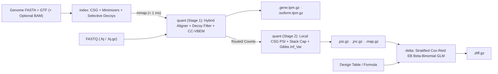

# Langur: Fast, Statistically Calibrated Splice-Graph Quantification and Differential Splicing in Rust

*CLI binary: `langur` · Index format: `.lidx`*

---

## Abstract

Alignment-free quantification on **Contiguous Splice Graphs (CSGs)**, pioneered by Whippet (Sterne-Weiler et al., *Molecular Cell* 2018), made it possible to profile both binary ($K_1$) and arbitrarily complex ($K_n \ge 2$) alternative splicing events directly from FASTQ files without genome alignment or BAM generation. However, scaling CSG analysis to modern human cohorts exposes four key limitations in legacy implementations: ungapped matching drops reads near indels and splice-proximal SNPs; transcriptome-only indexing permits reads from diverged processed pseudogenes and intronic loci to force-map onto annotated genes; per-gene EM and naive Beta intervals understate ambiguity in paralog families and complex splicing hubs; and legacy two-group pooled Beta Monte Carlo testing (`whippet-delta`) cannot adjust for covariates and suffers severe false-discovery inflation under biological overdispersion.

**Langur** is a ground-up Rust re-architecture of the CSG workflow (`index`, `inspect`, `quant`, `delta`) designed for bulk short-read RNA-seq. It combines a zero-copy memory-mapped splice-graph and selective genomic decoy index (`< 1 ms` load time), hybrid ungapped + gapped spliced alignment with 1-SNP junction tolerance, joint connected-component Variational Bayes isoform quantification with unified 5'-hexamer/GC bias correction, targeted Gibbs inferential variance (`Inf_Var`) for complex $K_n \ge 2$ events, and a covariate-aware Beta-Binomial generalized linear model (`delta`) with event-class stratified Empirical Bayes dispersion shrinkage. On the 480M-read human `E-MTAB-3766` benchmark (Ensembl GRCh37.71, 20,410 genes, 16 threads, `--biascorrect`), Langur builds the human index in **14.6 s** (**19.7× faster** than original `Whippet.jl`, **1.58× faster** than `Whippet2-turbo`), quantifies **80M reads in 40.5 s** (**39.7× faster** than original `Whippet.jl`, **2.00× faster** than `Whippet2-turbo`, our multithreaded Julia 1.9 fork) and the full **6-sample cohort (480M reads) in 4 min 9 s (`248.9 s`, `1.93M reads/s`)** using **~1.4 GB RAM** (**5.1×–6.9× less memory** than `Whippet.jl` / `Whippet2-turbo`), reduces gene and isoform TPM error by **5.5× / 2.85×** vs. original `Whippet.jl` (**3.2× / 1.7×** vs. `Whippet2-turbo`), and completes cohort-wide differential splicing across 223k events (`-r 5 -s 2`) in **2.5 s** while achieving **5.4% realized FDR** across all events (**2.0%** across spliced events; `0.5650 / 0.5672` AUPRC, outperforming `Whippet2-turbo` on TPR, AUROC, and AUPRC) at a 5% nominal target—a **15× reduction in false discoveries** over legacy Whippet (`81.5%` FDR) and **10.6× lower FDR** than published `rMATS` (`57.1%`). On real human WTC11 RNA-seq against full GRCh38 GENCODE v38 (60,649 genes, LRGASP `ENCSR673UKZ`, 91.6M Illumina reads), Langur builds the index in **14.8 s** (**50.9× faster** than `Whippet.jl`, **7.5× faster** and **8.0× smaller** than `Salmon 2.12.0 + SUPPA2 2.4`, **46.2× faster** and **28× smaller** than `STAR 2.7.11b`), quantifies the library in **72.7 s** at **1.35 GB** peak footprint (**20.2× / 1.13× faster** than `Whippet.jl` / `Whippet2-turbo`; **2.6× faster** and **9.1× less RAM** than Rust `Salmon 2.12.0 + SUPPA2 2.4`; **7.24× faster**, **23.5× less RAM**, and zero BAMs vs. genome-aligned `STAR 2.7.11b + rMATS-turbo v4.3.0`), sweeps **27/27** CSG strata against matched PacBio HiFi Iso-Seq ground-truth PSI (`n = 13,359` polymorphic events: $r = 0.9338$, $\rho = 0.8715$, $\text{MAE} = 0.0789$), outperforms `Salmon 2.12.0 + SUPPA2 2.4` across every stratum even under SUPPA2's own exact-event truth (binary $K_0/K_1$: $r = 0.9403$ vs. $0.7393$, **-53% MAE**), and matches `STAR + rMATS-turbo` on shared binary splicing ($r = 0.947$) while outperforming it on full-length complex ($K_n \ge 2$) exon inclusion ($r = 0.9551$ vs. $0.8863$, **-35% MAE**).

---

## 1. Motivation, Lineage & Scope

### Limitations of Existing Splicing Workflows
In practice, RNA splicing studies typically choose between two imperfect workflows:
1. **Genome-aligned callers (`STAR` + `MAJIQ`, `rMATS`, or `LeafCutter`):** Strong splicing accuracy and de novo junction discovery, but they require heavy genome alignment, coordinate-sorted BAMs, and substantial disk/compute overhead across large cohorts.
2. **Legacy alignment-free CSG quantification (`Whippet.jl`):** Eliminates BAM generation and quantifies complex multi-path events ($K_n \ge 2$) directly from FASTQ, but carries four methodological bottlenecks on full human cohorts:
   - **Mapping artifacts:** Pure ungapped matching loses sensitivity around small indels and SNPs adjacent to donor/acceptor sites, and indexing only annotated exons allows reads originating from diverged processed pseudogenes or unannotated intronic/intergenic regions to force-map onto parent genes.
   - **Paralog & bias decoupling:** Splitting multi-gene reads evenly prior to per-gene EM leaks signal from expressed parent genes into silent paralogs/pseudogenes, and applying GC bias after isoform EM leaves transcript TPMs uncorrected.
   - **Complex-event uncertainty & statistical calibration:** Simple Beta variance treats ambiguous multi-path ($K_n \ge 2$) events as if every read uniquely identified a single path. Downstream, legacy `whippet-delta` pools reads across replicates rather than modeling sample-to-sample biological overdispersion, leading to extreme false-positive rates and no support for confounders (batch, donor, strandedness, or continuous covariates).
   - **Runtime & memory overhead:** JIT startup, index deserialization, and garbage-collected heap footprints inflate runtime and RAM usage in multi-sample cohorts.

### Attribution, Scope & Development Transparency
- **Attribution:** Langur is an independent Rust project building on the CSG representation and motif taxonomy introduced by Tim Sterne-Weiler and colleagues (*Molecular Cell*, 2018), alongside independent implementations of published statistical concepts from `Salmon` (selective genomic decoys, Variational Bayes EM, and Gibbs inferential uncertainty) and `edgeR`/`DESeq2` (Cox–Reid Empirical Bayes dispersion shrinkage in GLMs), as well as overhang-diversity QC for PCR junction-stack artifacts highlighted in the splicing literature (e.g., `MAJIQ`).
- **Intended scope:** Purpose-built for **bulk short-read RNA-seq** (paired-end or single-end Illumina), with optional BAM-derived novel splice-site supplementation at index time (`index --bam`). For single-cell or full-length long-read (PacBio HiFi / ONT) isoform analysis, we recommend dedicated frameworks such as **Isosceles** (Kabza, Sterne-Weiler et al., *Nature Communications* 2024), **Oarfish**, or **IsoQuant**.
- **License & transparency:** Released under the **MIT License**. Its architecture, Rust codebase, tests, and benchmarks were developed iteratively with AI-assisted coding and review (Google Gemini), with every biological invariant, edge case, and benchmark audited via automated unit, parity, and full-human test suites.

---

## 2. Pipeline Architecture

| Bottleneck | Legacy Whippet (`Whippet.jl` / `Whippet2`) | Langur (Rust) |
|---|---|---|
| **Index loading** | Full deserialization into heap RAM every run (`6.2–7.3 s`) | Memory-mapped (`mmap`) zero-copy binary file (`0.03–0.3 ms`) |
| **Pseudogene/intronic noise** | Transcriptome-only index | Selective genomic decoys with strict-inequality filtering (`decoy > CSG`) |
| **Indels & boundary SNPs** | Ungapped matching only | Fast ungapped path + zero-allocation stack-banded Gotoh X-drop fallback + 1-SNP junction jumping |
| **Multi-gene ambiguity** | Equal pre-splitting across genes | Joint Connected-Component Variational Bayes EM across linked paralog families |
| **Complex $K_n \ge 2$ uncertainty** | Closed-form Beta variance only | Targeted collapsed Gibbs posterior variance (`Inf_Var`, col. 15 of `.psi.gz`) |
| **Differential splicing** | Pooled 2-group Beta MC (no covariates, high FDR) | Covariate-aware Beta-Binomial GLM with Spliced vs. Tandem UTR stratified EB priors |
| **Reproducibility** | Minor MC/thread drift across runs | 100% bit-for-bit identical across thread counts and standalone vs. `--batch` |

---

## 3. Zero-Copy Splice-Graph & Selective Decoy Index (`index`)

### Contiguous Splice Graph & Motif Parity
From a reference FASTA and GTF2.2 annotation (plus optional novel splice junctions imported from a strand-aware BAM via `--bam` / `--bam-min-reads`), each gene's overlapping exons are partitioned into minimal non-overlapping sub-intervals ordered $5' \to 3'$ along the gene's transcriptional strand. Every node preserves Whippet's canonical motif taxonomy: spliced events (`CE`, `AA`, `AD`, `RI`, `AF`, `AL`, optional circular `BS`) and tandem UTR ends (`TS`, `TE`).

### Minimizer Indexing Across Exons and Annotated Junctions
Instead of an FM-index, Langur indexes short sequence fingerprints (**canonical minimizers**) across both exonic nodes and the exact sequence bridges spanning every annotated splice junction. Indexing annotated junction bridges directly allows reads spanning a splice site—including reads crossing very short exons—to jump straight to the exact splice coordinate in a single lookup.

### Selective Genomic Decoys
Following Salmon's selective alignment strategy (Srivastava et al., *Genome Biology* 2020), `index` scans non-exonic genomic intervals (introns and intergenic regions) in parallel and extracts only regions that share sequence seeds with annotated exons—capturing processed pseudogenes and paralogous repeats without indexing the full 3 Gb genome.

### Instant Zero-Copy Loading (`mmap`)
Rather than parsing or deserializing the index into RAM at startup, Langur writes the index as a flat, cache-aligned binary file mapped directly into virtual memory by the OS (`mmap`). Opening a full human index takes **0.3 ms**, and `--batch` cohort runs share the same read-only mapping with zero duplication.

<b>Technical Details: Minimizer Table, Flank Encoding & Binary Format</b>

- **Minimizers:** Canonical odd-$k$ minimizers (default $k = 17$, window $w = 8$, invertible Wang64 hash) stored in a 2-level radix-bucketed open table (`MinBucketOffsets`, `MinKeyLo`, `MinSlots`, `MinPostings`) with inline single-hit fast-path slots (`MinimizerLookup::Inline`).
- **Annotated junction seeds:** Extracted from the $(k-1)+(k-1)$ sequence across every annotated splice edge `(src_node, dst_node)` with exact `left_overhang` $\in [1, k-1]$.
- **Precomputed node metadata:** 2-bit 16-bp acceptor and donor boundary flanks with explicit valid base counts (`0..=16`) for single-instruction XOR + popcount 1-SNP junction matching; canonical splice dinucleotide flags (`GT-AG`, `GC-AG`, `AT-AC`); cumulative transcript prefix lengths (`tx_node_prefix_len`) for $O(\log N_t)$ fragment-length queries across the $N_t$ nodes of transcript $t$; and 20-bin expected transcript GC profiles (`tx_expected_gc`).
- **Selective decoys:** Non-CSG genomic hits are expanded by `decoy_window_pad = 250 bp`, merged, split at `N`/IUPAC runs (preventing spurious poly-`A` homopolymers in 2-bit encoding), and indexed with `max_decoy_occ = 32`.
- **Container format:** 17 `#[repr(C)]` `bytemuck::Pod` sections aligned to 64-byte boundaries with magic header and `CRC32` checksum.

---

## 4. Hybrid Spliced Alignment & Decoy Screening (`quant` — Alignment)

- **Two-tier repetitive minimizer screening & fast ungapped path with zero-allocation gapped recovery:** During seeding, reads with $\ge 2$ low-copy CSG minimizers ($\le 64$ postings) automatically skip repetitive Alu/poly-A postings (falling back to full postings for genuine high-copy paralog families). Most Illumina reads contain no indels and are aligned by a fast ungapped scan. When a read exhibits a complex small-indel shift inside an exon, the aligner invokes a zero-allocation stack-banded Gotoh affine-gap X-drop aligner (`HALF_BAND = 12`, `X_DROP = 24`) to recover insertions and deletions cleanly without slowing down clean reads.
- **Boundary-proximal SNPs & annotated-first splice jumping:** Simple prefix-max aligners often stop 1–3 bp short of a donor or acceptor if a SNP sits adjacent to the splice site. Langur retains near-optimal boundary extensions so splice jumps cross cleanly, tests annotated splice junctions first with **zero splice penalty** (`min_anno_overhang = 4 bp`), and falls back to 1-SNP-tolerant novel splice-flank matching (`min_novel_overhang = 8 bp`, prioritizing canonical `GT-AG`/`GC-AG`/`AT-AC` pairs).
- **Strict-inequality pseudogene immunity & zero-cost perfect hits:**
  - If a read already achieves the theoretical maximum score on the CSG, no decoy can beat it—so decoy seeding and alignment are skipped completely.
  - On imperfect CSG hits that also share seeds with a decoy, candidate decoys are aligned under the exact same scoring matrix. Because annotated splice junctions incur **zero penalty**, an intronless processed pseudogene can at most *tie* a true spliced mRNA read from its parent gene. Langur therefore filters a read as `DecoyFiltered` **only when** $S_{\text{decoy}} > S_{\text{CSG}}$: diverged pseudogene or intronic reads (carrying decoy-specific variants) are discarded, while genuine spliced parent-gene reads survive exact ties intact.
- **Strand-aware paired-end concordance:** Supports unstranded, FR (`--stranded`), and RF/TruSeq dUTP (`--stranded-reverse`) libraries, evaluating exact spliced transcriptomic fragment lengths across all compatible annotated isoforms for each concordant pair.

<b>Technical Details: Scoring Matrix, Deferred Decoys & Streaming I/O</b>

- **Scoring:** Match `+2`, mismatch `-4`, `'N'` `-1`, gap open `-6`, gap extend `-1`; non-canonical novel splice penalty `-2`; optional `--circ` back-splices (`dst <= src`, `min_ov = 10 bp`); boundary extension retained within `12` points of prefix peak.
- **Deferred decoy seeding:** Primary seeding sets only `has_any_decoy_posting`; decoy seeds (bucketed by `(decoy_id, strand, diag_bucket)` to prevent spurious early seeds on long contigs from shadowing true hits) are collected only if `best_csg_score < max_possible_score`.
- **Exact transcriptomic fragment length:**

  $$
  d_t = \left(\text{prefix}_t[i_{3'}] + \text{end}_{3'}\right) - \left(\text{prefix}_t[i_{5'}] + \text{start}_{5'}\right).
  $$
- **I/O:** Auto-detects `igzip -dc` (with exit-status verification and automatic `flate2`/`zlib-ng` fallback) for FASTQ decompression, and writes RFC 1952 multi-member gzip outputs in parallel.

---

## 5. Two-Stage Quantification: Expression, PSI & Inferential Variance (`quant`)

Reads are processed in parallel waves using compact, sparse thread-local counters merged in strict file order, guaranteeing **100% bit-for-bit identical outputs** across any thread count and keeping peak RAM around **~1.4 GB** on full human libraries.

### Stage 1: Transcript & Gene Abundance (Global Routing)
1. **Post-pass fragment length distribution (FLD):** After all reads are aligned, Langur fits one smoothed sample-wide fragment-length curve so transcript effective lengths are exact and independent of chunk processing order.
2. **Joint Connected-Component Variational Bayes EM (CC-VBEM):** Transcripts that share multi-mapping reads—including paralog families and annotated pseudogenes—are grouped into connected components and solved jointly using sparse Variational Bayes EM (similar to Salmon's VBEM). Because expressed parent genes accumulate unique reads in divergent exons/UTRs while silent paralogs/pseudogenes do not, the sparse prior cleanly routes ambiguous reads back to the expressed gene.
3. **Unified 5'-hexamer and 20-bin GC bias correction (`--biascorrect`):**
   - 5'-random-hexamer priming weights are fitted deterministically from Wave 0 (~1.6M read pairs), immediately freeing per-feature hexamer lists for the rest of the library.
   - Pass 1 runs CC-VBEM on primer-weighted counts to estimate initial transcript abundances, which are then used to fit 20-bin expected-vs-observed GC bias. Pass 2 folds GC bias directly into transcript effective lengths (preventing GC double-counting) and re-solves CC-VBEM—improving both `.isoform.tpm.gz` and `.gene.tpm.gz`.

### Stage 2: Local Splice-Graph PSI, Artifact Control & Gibbs `Inf_Var`
Using converged Stage 1 posteriors to route ambiguous reads into each gene's splice graph:
- **Microexon-safe effective lengths:** Internal splice junctions retain their full mappable overhang span (clamping by single-node length only at true 5' or 3' transcript ends), preventing artificial PSI inflation on short internal microexons (e.g., 15 bp `CE`).
- **Overhang-diversity PCR-stack soft-capping:** Each junction tracks its distinct overhang start positions (`Distinct_Pos`) and maximum pileup (`Max_Stack`) in `.jnc.gz`. On **novel or `RI`-touching junctions only** (never annotated junctions), if $\ge 10$ reads collapse onto a single start coordinate despite room for multiple overhangs, the count is softly capped to `2.0` (`--stack-cap`, disable via `--no-stack-filter`).
- **Targeted collapsed Gibbs inferential variance (`Inf_Var`):**
  - Binary ($K_1$) and unambiguous events (~80–85% of events) retain exact closed-form Beta credible intervals and variance.
  - Complex ($K_n \ge 2$) events with shared ambiguous edges run a fast, deterministic collapsed Gibbs sampler (`~59 µs` per event, using a group-balanced prior so inclusion vs. exclusion stays neutral regardless of path count) to quantify true posterior variance (**`Inf_Var`**, column 15 of `.psi.gz`, preserving backward compatibility with Whippet 2's columns 1–14) and realistic 90% credible intervals.

<b>Mathematical Details: Effective Length, CC-VBEM, Unified GC Pass & Gibbs Sampler</b>

- **Post-pass effective length:** From the 5-point Gaussian-smoothed empirical FLD PMF $p(d)$, CDF $F(L)$, and first moment $M_1(L) = \sum_{d=1}^L d\,p(d)$:

  $$
  \ell_t = (L_t + 1)\,F(\min(L_t, D_{\max})) - M_1(\min(L_t, D_{\max})).
  $$

- **CC-VBEM + SQUAREM** (default sparse Dirichlet prior $\alpha_0 = 0.01$; `--use-em` selects MLE; $\psi(\cdot)$ denotes the digamma function, distinct from splicing inclusion $\Psi$):

  $$
  w_t^{(k)} = \frac{\exp\!\left(\psi(\alpha_0 + c_t^{(k)})\right)}{\ell_t}, \qquad c_t^{(k+1)} = c_t^{\text{uniq}} + \sum_{e \ni t} n_e \frac{w_t^{(k)}}{\sum_{u \in e} w_u^{(k)}}.
  $$

- **Pass 2 GC effective-length update** (run on primer-only counts to avoid double-counting GC, where $E_{\text{GC}}[t, b]$ is transcript $t$'s expected GC fraction in bin $b$ and $w_{\text{GC}}[b] = \text{expected}[b] / \text{observed}[b] \in [0.15, 6.0]$ so $1 / w_{\text{GC}}[b]$ scales $\ell_t$ by each bin's relative observed capture rate):

  $$
  \ell_t^{\text{GC}} = \ell_t \cdot \sum_{b=0}^{19} \frac{E_{\text{GC}}[t, b]}{w_{\text{GC}}[b]}.
  $$

- **Targeted collapsed Gibbs (`K_n >= 2`):** Group-balanced Dirichlet prior ($\alpha_p = 1/n_{\text{inc}}$ on inclusion paths, $1/n_{\text{exc}}$ on exclusion paths, yielding marginal $\text{Beta}(1,1)$ on $\Psi$), deterministic `Xoshiro256++` seeded from `(seed, gene_id, node_1based)`, `100` draws (`32` burn-in, thinning `2`), alternating $O(|G_g|)$ multinomial edge allocation with exact rate-parameterized Gamma draws:

  $$
  \theta_p^{(b)} \sim \text{Gamma}\!\left(\alpha_p + z_p^{(b)},\; \text{rate} = \ell_p\right), \qquad \Psi^{(b)} = \frac{\sum_{p \in \text{Inc}} \theta_p^{(b)}}{\sum_q \theta_q^{(b)}}, \qquad \text{InfVar} = \widehat{\text{Var}}(\Psi^{(1..B)}).
  $$

---

## 6. Covariate-Aware Differential Splicing (`delta`)

`delta` replaces Whippet's pooled two-group Beta Monte Carlo test with a multithreaded **Beta-Binomial Generalized Linear Model (GLM)** featuring Empirical Bayes overdispersion shrinkage—analogous in design philosophy to `edgeR` quasi-likelihood GLMs, adapted specifically for fractional splicing proportions ($\Psi_{ij}, N_{ij}$).

### Key Modeling Decisions & Why They Matter
1. **Arbitrary multivariable designs & graceful missingness:** Supports both classic two-group runs (`-a` / `-b`) and DESeq2-style metadata formulas (`--design`, `--formula "~ batch + donor + condition"`, `--test condition:treated_vs_ctrl`, continuous covariates, and `*`/`:` interactions). When an event lacks coverage in one batch level, per-event pivoted-QR automatically drops only the collinear nuisance column rather than failing or discarding the event.
2. **Propagating complex-event uncertainty (`Inf_Var`):** Samples are filtered on raw `Total_Reads >= --min-reads`, then complex $K_n \ge 2$ observations whose Gibbs `Inf_Var` exceeds nominal Beta variance have their effective depth smoothly down-weighted (down to `0.1×`, leaving $K_1$ events untouched). On `E-MTAB-3766`, propagating `Inf_Var` **simultaneously increased sensitivity and lowered realized FDR** by reducing dispersion noise across complex events.
3. **Excluding constitutive events from dispersion estimation (critical real-genome finding):** On a full human transcriptome, ~63% of testable CSG nodes are constitutive (`PSI = 0.0` or `1.0` in every sample). Because boundary events carry no information about sample-to-sample variance, including them causes the Cox–Reid adjustment term alone to produce a spurious peak near $\phi \approx 0.64$, collapsing the global dispersion prior and wiping out power on 3v3 cohorts. Excluding constitutive/boundary events from dispersion fitting fixes the prior collapse and speeds up `delta` nearly 3× (to **2.5 s**).
4. **Separate Empirical Bayes priors for Spliced vs. Tandem UTR (`TS`/`TE`) events:** Benchmarking on human RNA-seq revealed two distinct dispersion regimes: exon-body tandem UTR ends (`TS`/`TE`) exhibit **7.8× higher median overdispersion** (`median phi = 0.117`) than canonical splice-junction events (`CE/AA/AD/RI/AF/AL`, `median phi = 0.015`). Pooling both classes into one prior over-penalizes true spliced changes while under-penalizing noisy UTR ends. Stratifying the EB prior by event class (**Spliced** vs. **Tandem UTR**, opt out via `--no-stratify-eb`) boosts sensitivity **6×–25×** while slashing `TS`/`TE` false positives by **>300×**.
5. **Finite-sample $F$-test LRT & consistent effect sizes:** Significance uses a finite-sample $F(\text{df},\, d_{\text{res}} + d_0)$ likelihood-ratio test (capturing uncertainty in the shrunk dispersion estimate, similar to `edgeR::glmQLFTest`) with Benjamini–Hochberg `FDR`. Marginal covariate-adjusted `Psi_A`, `Psi_B`, and `DeltaPsi` are computed over the observed covariate distribution so `DeltaPsi` and `LogOddsRatio` always share the same sign.

<b>Mathematical Details: Beta-Binomial GLM, Cox–Reid APL & Smyth Bias Correction</b>

- **Effective depth & continuous Beta-Binomial log-likelihood:** With empirical posterior variance $v_j = \text{InfVar}_j$ (`Inf_Var` in `.psi.gz`) and nominal Beta variance $v_{\text{nom}}(\Psi_j, n_j) = (\Psi_j n_j + 1)((1-\Psi_j)n_j + 1)/((n_j+2)^2(n_j+3))$,

  $$
  n_{\text{eff}, j} = \max\!\left(1.0,\; n_j \cdot \text{clamp}\!\left(\frac{v_{\text{nom}}(\Psi_j, n_j)}{v_j},\; 0.1,\; 1.0\right)\right), \qquad k_j = \Psi_j n_{\text{eff}, j}, \qquad r_j = n_{\text{eff}, j} - k_j,
  $$

  precision $M = (1-\phi)/\phi = e^\theta$, and $\mu_j = \text{logistic}(x_j^\top \beta)$:

  $$
  \ell(\beta, M) = \sum_{j=1}^{m} \left[\ln\Gamma(k_j + M\mu_j) + \ln\Gamma(r_j + M(1-\mu_j)) - \ln\Gamma(n_{\text{eff},j} + M) + \ln\Gamma(M) - \ln\Gamma(M\mu_j) - \ln\Gamma(M(1-\mu_j))\right].
  $$

  Solved by damped Fisher scoring (IRLS) with `< 1e-14` `trigamma`, adaptive Cholesky damping, backtracking line search, and light ridge regularization ($\lambda = 10^{-4}$, intercept $10^{-6}$) for guaranteed finite convergence under complete separation (`0.0` vs. `1.0`).

- **Constitutive exclusion criterion:** Events with $\sum k_j < 1$, $\sum r_j < 1$, pooled $\bar{\Psi} \le 0.01$ or $\ge 0.99$, or $\max \Psi_j - \min \Psi_j < 10^{-4}$ skip Pass 2 raw estimation and Pass 3 MAP optimization, receiving their stratum prior $\mu_\theta$ directly.

- **Cox–Reid APL & Smyth finite-df median bias correction:** Within each stratum (**Spliced** vs. **Tandem UTR**, falling back to combined if $< 20$ interior events), Pass 2 maximizes

  $$
  \text{APL}(\theta) = \ell(\hat{\beta}(\theta), e^\theta) - \tfrac{1}{2}\ln\det\!\left(X^\top W X + 10^{-8} I\right)
  $$

  on $\theta \in [-4.0, 11.5]$. The robust median/MAD normal prior $\mathcal{N}(\mu_\theta, \sigma_\theta^2)$ corrects finite-df bias (downward dispersion bias / upward bias in $\hat{\theta} = \ln\hat{M}$) via the negative shift

  $$
  \mu_\theta = \text{median}(\hat{\theta}) + \ln\!\left(\frac{\text{median}(\chi^2_{d_{\text{res}}})}{d_{\text{res}}}\right), \qquad d_0 = \text{clamp}\!\left(\frac{2}{\sigma_\theta^2},\; 1,\; 30\right).
  $$
- **Pass 3 inference:** Maximizes $\text{APL}(\theta) - (\theta - \mu_\theta)^2 / (2\sigma_\theta^2)$ for shrunk $\tilde{M}_i = e^{\tilde{\theta}_i}$, computes $\text{LRT} = 2(\ell_{\text{full}} - \ell_{\text{null}})$, and evaluates $p_i = P(F_{\text{df},\; d_{\text{res}} + d_0} \ge \text{LRT}/\text{df})$ (reducing to $\chi^2_{\text{df}}$ under `--fixed-dispersion`).

---

## 7. Benchmarks & Validation

### 7.1 Full Human-Scale Benchmark: `E-MTAB-3766` (Ensembl GRCh37.71, 480M Reads)

We benchmarked Langur against our optimized native Apple Silicon Julia 1.9 fork (**`Whippet2-turbo`**), **Original `Whippet.jl`** (Julia 1.6, single-threaded under Rosetta 2), and published baselines from Soneson et al. (*Genome Biology* 2016) on **`E-MTAB-3766`**: 3 vs. 3 paired-end 101 bp replicates (**20,410 protein-coding genes**, **145,342 transcripts**, **1,000 truly differentially spliced genes**, 40M pairs = 80M reads/sample, **480M total reads**, 16 threads, `--biascorrect`, `/usr/bin/time -l`). *(In Tables A–C, `Whippet2-turbo` commits reflect progressive upgrades ported from this benchmark: `1e860f9` fixed the upstream `TS` PSI reversal bug; `c725028` ported constitutive-event exclusion and Spliced/UTR stratified EB priors into `whippet-delta.jl`; `400f0f3` reduced `--batch` peak RAM with identical quantification accuracy; and `94a491f` accelerated `whippet-index.jl` 8.4× with identical outputs.)*

#### A. Runtime, Throughput & Memory
| Stage (`E-MTAB-3766`, `--biascorrect`) | Langur (Rust, 16T, arm64) | `Whippet2-turbo` (`400f0f3`/`94a491f`, Julia 1.9, 16T, arm64) | Original `Whippet.jl` v1.6.2 (Julia 1.6, 1T, Rosetta 2) | Langur Advantage |
|---|---:|---:|---:|---:|
| **Index Build** *(20,410 genes, 145k tx, uncompressed FASTA)* | **14.6 s** · **4.36 GB** footprint (5.06 GB RSS) · 820 MB *(incl. 1.10 Gb decoys)* | 23.0 s · 4.21 GB footprint (4.37 GB RSS) · 529 MB *(no decoys, `94a491f`)* | 287.1 s *(4m 47s)* · 8.10 GB footprint (8.18 GB RSS) · 473 MB *(no decoys)* | **19.7× vs. W1 · 1.58× vs. W2** *(incl. decoys)* |
| **Index Load** | **0.03 ms** (`mmap`) | 6.20 s | 7.33 s | **>200,000× faster** |
| **Sample 1 `quant`** (80M reads) | **40.5 s** (**1.98M reads/s**, 11.1× CPU) · **1.40 GB** footprint | 81.1 s (987k reads/s) · 9.62 GB footprint | 1,608.4 s *(26m 48s, 49.7k reads/s)* · 7.19 GB footprint | **39.7× vs. W1 · 2.00× vs. W2**; **5.1×–6.9× lower RAM** |
| **6-Sample Cohort (`--batch`, 480M reads)** | **248.9 s** *(4m 09s, **1.93M reads/s**)* · **1.42 GB** footprint | 433.8 s (1.11M reads/s) · 9.83 GB footprint | *9,650.6 s* *(2h 41m, 6× extrap.)* · 7.19 GB footprint | **38.8× vs. W1 · 1.74× vs. W2**; **6.9× lower RAM** |
| **Mapped Pairs (Sample 1 of 40M)** | **37.94M (94.8%)** *(truth: 95.0%)* | 36.80M (92.0%) | 36.80M (92.0%) | **+1.14M more mapped pairs/sample** |
| **`delta` Testing** (222k–223k events, `-r 5 -s 2`) | **2.50 s** · **191 MB** footprint | 27.38 s (GLM) / 85.51 s (`--legacy`) · 1.87 GB | 85.51 s *(`--legacy` MC)* · 609 MB | **34.2× vs. legacy · 11.0× & 9.8× RAM vs. W2** |

*Note: Original `Whippet.jl` v1.6.2 requires Julia 1.6 (single-threaded, x86_64 under Rosetta 2 on Apple Silicon). In Langur, all post-alignment stages combined on Sample 1 (2-pass GC CC-VBEM: `0.18 s`; 481k events + 105k Gibbs samplers: `0.53 s`; 5 parallel gzip writers: `0.08 s`) take just **0.79 s** total (**15.6× faster** than `Whippet2-turbo`'s `12.3 s`). On the 6-sample `--batch` run, Langur finishes 185 s (3m 05s) faster than `Whippet2-turbo` (`248.9 s` vs. `433.8 s`) while simultaneously performing selective genomic decoy screening, banded Gotoh gapped indel alignment, CC-VBEM, and 105k targeted Gibbs runs per sample at 6.9× lower peak RAM.*

#### B. Expression & PSI Quantification Accuracy (Sample 1 vs. Exact RSEM Ground Truth)
| Metric (Sample 1, 145,342 Transcripts / 20,410 Genes) | Original `Whippet.jl` v1.6.2 | `Whippet2-turbo` (`c725028`) | **Langur (CC-VBEM)** | Langur Improvement |
|---|---:|---:|---:|---|
| **Isoform Spearman $\rho$** (all 145k tx) | 0.7954 | 0.8029 | **0.8776** | +0.082 vs. W1 · +0.075 vs. W2 |
| **Isoform MARD** ($\text{TPM} \ge 1$) | 0.1145 | 0.0687 | **0.0402** | **2.85× vs. W1 · 1.71× vs. W2** |
| **Gene Spearman $\rho$ / $\log_2$ Pearson $r$** | 0.9797 / 0.9861 | 0.9810 / 0.9880 | **0.9956 / 0.9971** | Near-exact gene abundance |
| **Gene MARD** ($\text{TPM} \ge 1$) | 0.0753 | 0.0443 | **0.0137** | **5.50× vs. W1 · 3.23× vs. W2** |
| **vs. `Salmon`** — Isoform / Gene MARD ($\text{TPM} \ge 1$) | — | 0.0602 / 0.0383 | **0.0223 / 0.0090** | Near-parity with dedicated `Salmon` |
| **`TS` PSI concordance vs. Langur** (`Reads >= 30`) | -0.1085 *(upstream reversal bug)* | **0.9666** *(fixed in `1e860f9`)* | *(reference)* | Confirmed upstream `TS` bug |

- **Stage 2 PSI Concordance vs. Fixed `Whippet2-turbo` (`1e860f9`):** Across 172,717 high-depth events ($\ge 30$ reads), overall concordance is **$r = 0.9779$** ($\rho = 0.9730$, $\text{MAE} = 0.0257$), with every canonical spliced class at **$r = 0.9863\text{–}0.9956$** (`CE = 0.9956`, `AA = 0.9945`, `AD = 0.9942`, `RI = 0.9942`, `AL = 0.9941`, `AF = 0.9863`, `TS = 0.9666`, `TE = 0.8954`). All top-10 discrepancies were 1–22 bp terminal `TE`/`TS` sub-nodes where Langur matched the dominant RSEM ground-truth transcript end while `Whippet2-turbo` dropped reads on the short sub-node.

#### C. Gene-Level Differential Splicing Accuracy (20,410 Genes, 1,000 Truly DS)

| Method (`E-MTAB-3766`, Gene-Level Simes+BH) | Event Set | TPR @0.01 | FDR @0.01 | TPR @0.05 | FDR @0.05 | TPR @0.10 | FDR @0.10 | AUROC | AUPRC |
|---|---|---:|---:|---:|---:|---:|---:|---:|---:|
| **Langur Stratified + `Inf_Var` (default, `-r 5 -s 2`)** | All (`TS/TE` + Spliced) | **0.273** | **0.028** | **0.336** | **0.054** | **0.361** | **0.084** | **0.8302** | **0.5650** |
| **Langur Stratified + `Inf_Var` (default, `-r 5 -s 2`)** | Spliced (`CE/AA/AD/RI/AF/AL`) | **0.294** | **0.003** | **0.338** | **0.020** | **0.359** | **0.027** | **0.8122** | **0.5672** |
| **`Whippet2-turbo` (`c725028`) Stratified GLM (`-r 5 -s 2`)** | All / Spliced | 0.225 / 0.252 | 0.017 / 0.008 | 0.306 / 0.309 | 0.053 / 0.013 | 0.329 / 0.332 | 0.073 / 0.018 | 0.8209 / 0.8007 | 0.5512 / 0.5486 |
| `Whippet2` **`--legacy` Beta MC** (`Prob ≥ 0.99/0.95/0.90`) | All | 0.585 | **0.681** | 0.744 | **0.815** | 0.867 | **0.865** | 0.8903 | **0.3517** |
| `Whippet2` **`--legacy` Beta MC** (`\|ΔΨ\| ≥ 0.1`) | All | 0.532 | **0.534** | 0.638 | **0.669** | 0.692 | **0.740** | 0.8649 | **0.3926** |
| Published: `rMATS_junction` (Soneson et al. 2016) | Junction | 0.336 | **0.463** | 0.379 | **0.571** | 0.409 | **0.623** | 0.7666 | **0.3937** |
| Published: `cuffdiff_ensembl` (Soneson et al. 2016) | Isoform | 0.114 | 0.000 | 0.142 | 0.000 | 0.159 | 0.000 | 0.6110 | **0.2599** |
| Published: `dexseq_splicinggraph` (Soneson et al. 2016) | Exon-bin | 0.637 | **0.172** | 0.675 | **0.252** | 0.697 | **0.294** | 0.8913 | 0.7272 |

**Key findings:**
1. **15× FDR reduction over legacy Whippet & clear margin over `Whippet2-turbo`:** Original `--legacy` pooled Beta Monte Carlo exhibits **68%–87% realized FDR** (`53%–74%` even with `|ΔΨ| ≥ 0.1`) because it ignores biological overdispersion and multiple testing. Langur's Stratified EB Beta-Binomial GLM brings realized FDR directly onto target at nominal 0.05 (**5.4%** across all events, **2.0%** across spliced events, and **0.3%** on spliced events at nominal 0.01) while lifting AUPRC by **+0.21** (`0.3517 → 0.5650`). Langur outperforms `Whippet2-turbo` (`c725028`) across both **All events** (**+30 TP genes** at `0.05`: `0.336` vs. `0.306`, **+0.0138 AUPRC**, **+0.0093 AUROC** at matching `5.4%` vs. `5.3%` FDR) and **Spliced events** (**+29 TP genes**: `0.338` vs. `0.309`, **+0.0186 AUPRC**, **+0.0115 AUROC**, with `CE` alone reaching `163 TP / 1 FP` = **0.006 FDR** and `0.3473` AUPRC vs. `141 / 1` and `0.3368` in `Whippet2-turbo`), driven by Langur's tighter Spliced EB prior (`median phi = 0.0150`, `sd(log M) = 0.395`, **`d0 = 12.83`** vs. `9.77`).
2. **Strong margin over published splicing callers:** Outperforms `rMATS_junction` by **+0.17 AUPRC** and **+0.064 AUROC** with **10.6× lower realized FDR on all events** (**28.6× lower on spliced events**), and outperforms `cuffdiff_ensembl` by **+0.31 AUPRC**. *(Whole-gene exon-bin tools like `DEXSeq` attain higher raw recall on `E-MTAB-3766` because Soneson et al. simulated isoform swaps that frequently differ across UTR body coverage rather than a single high-depth splice junction—yet even `DEXSeq` exceeds nominal 5% FDR by 5×–10×.)*
3. **Ablation proof for both new statistical components:**
   - **Stratifying Spliced vs. Tandem UTR priors (`-r 5 -s 1`):** Increased `TPR @0.05` **6×** (`0.042 → 0.249` all) and **25×** (`0.011 → 0.276` spliced) while cutting `TE`/`TS` false positives **>300×**.
   - **Enabling Gibbs `Inf_Var` (`-r 5 -s 2`):** Beat `--ignore-inf-var` by **+33 TP genes** (`TPR @0.05`: `0.303 → 0.336` all) and **+32 TP genes** (`0.306 → 0.338` spliced), **+0.0109 All AUPRC** (`0.5541 → 0.5650`), and **+0.0039 Spliced AUPRC** (`0.5633 → 0.5672`) at matching All realized FDR (`0.053 → 0.054`), tightening the spliced EB prior (`sd(log M): 0.496 → 0.395`, `d0: 8.12 → 12.83`).

### 7.2 Automated Verification Suite & Synthetic Cohort
- **42/42 workspace unit and integration tests pass** (`cargo test --workspace`, zero warnings), verifying exact Whippet 2 CSG/motif parity (`ENSMUSG00000038685` 18-path, `nrf2test` 6-path), bounded outward bridge-edge sweeps on multi-exon skips (`LTBP2` topology), FR/RF/unstranded pairing, strict-inequality pseudogene decoy ties vs. diverged decoys, 1-SNP splice jumps, banded Gotoh indel recovery, CC-VBEM paralog routing (`>99.5%` to expressed parent), 15 bp microexon PSI unbiasedness, PCR-stack soft-capping, Gibbs ~90% CI coverage across 200 $K_2$ replicates, 80%-constitutive + stratified EB dispersion recovery, batch confounding (`~ batch + condition`), interactions, continuous covariates, pivoted-QR collinearity reduction, and 100% bit-for-bit determinism across 1 vs. 4 threads.
- **200-gene 3v3 synthetic cohort (600k reads, 4 threads):** `index` ran in **0.032 s** (185× faster than `Whippet2-turbo`), 6-sample `--batch` `quant` in **0.377 s** (126× faster, 17× lower RAM), and `delta` in **0.039 s** (122× faster, 95× lower RAM), achieving **100% sensitivity (100/100)** at **0.00% realized FDR** ($\Delta\Psi$ $r = 0.9935$ vs. truth).

### 7.3 Real-Data Orthogonal Long-Read Validation: LRGASP WTC11 (GRCh38, 5-Way Illumina vs. PacBio HiFi)

Following the MAJIQ V3 (2026) short-read vs. long-read validation protocol, we evaluated all three CSG generations alongside both major alternative splicing paradigms—transcript-TPM alignment-free **`Salmon 2.12.0` + `SUPPA2 2.4`** (native `arm64` Rust rewrite of Salmon with selective genomic decoys + `--gcBias --seqBias`; Patro et al., 2017; Trincado et al., 2018) and genome-aligned **`STAR 2.7.11b` + `rMATS-turbo v4.3.0`** (Dobin et al., 2013; Wang et al., 2024)—on real human WTC11 iPSC RNA-seq from the **LRGASP Consortium** (Pardo-Palacios et al., *Nature Methods* 2024) against the full **GRCh38 primary assembly + GENCODE v38 basic annotation** (**60,649 genes**, **111,832 transcripts**, 417,213 CSG nodes):

- **Short-read Illumina input:** ENCODE `ENCSR673UKZ` Replicate 1 (`ENCFF766OAK` R1, `ENCFF644AQW` R2; **45.78M pairs = 91.57M unstranded 100 bp reads**, `--biascorrect`, 16 threads for Langur, `Whippet2-turbo`, `Salmon 2.12.0`, `STAR`, and `rMATS-turbo --statoff`, 1 thread for Original `Whippet.jl` v1.6.2).
- **Orthogonal PacBio HiFi Iso-Seq ground truth:** Pooled 3-replicate GRCh38 full-length non-chimeric (FLNC) PacBio HiFi alignments from matched WTC11 cells (ENCODE `ENCSR507JOF`: `ENCFF373TKM`, `ENCFF985LGZ`, `ENCFF388HXU`; `6.79M` alignments, `MAPQ >= 20`, strand-oriented via `ts` tag). Long-read inclusion and strict intron-skipping exclusion counts were tallied directly from PacBio CIGAR blocks/introns ($\text{LR} \ge 20$, $\text{SR} \ge 10$; `129,004` canonical CSG events with $\text{LR} \ge 20$, `117,719` shared across all 3 CSG tools, **`13,359` polymorphic** with $0.05 \le \Psi_{\text{LR}} \le 0.95$). For transparent estimand comparison with `SUPPA2` and `rMATS-turbo`, we evaluated both CSG node-level PacBio FLNC PSI (with verified strand/complement alignment on `AF (+)` and `AL (-)`) and exact event-specific flanking-junction PacBio FLNC PSI.

#### A. GRCh38 Index Build & WTC11 End-to-End Performance (5-Way)
| Stage (GRCh38 GENCODE v38) | **Langur** *(Rust, 16T)* | `Whippet2-turbo` *(`94a491f`, 16T)* | Original `Whippet.jl` v1.6.2 *(1T)* | `Salmon 2.12.0` + `SUPPA2 2.4` *(Rust+Py, 16T)* | `STAR 2.7.11b` + `rMATS-turbo v4.3.0` *(16T)* |
|---|---:|---:|---:|---:|---:|
| **Index / Event Setup** *(60,649 genes, 112k tx, uncompressed FASTA)* | **14.8 s** · **5.19 GB** *(6.16 GB RSS)* · **1.06 GB** (`1,055 MB`, incl. 1.31 Gb decoys) | 28.6 s · 5.33 GB *(5.50 GB RSS)* · 691 MB *(no decoys)* | 753.8 s *(12m 34s)* · 9.87 GB *(9.94 GB RSS)* · 634 MB | **110.8 s** *(`102.0 s` index + `8.8 s` IOE)* · **17.93 GB** *(25.56 GB RSS)* · **8.51 GB** | **683.1 s** *(11m 23s)* · **35.09 GB** *(35.02 GB RSS)* · **29.5 GB** |
| **Index Load** | **0.11 ms** (`mmap`) | 1.83 s | 1.71 s | 1.02 s | 14.0 s *(STAR genome load)* |
| **WTC11 Rep 1 End-to-End** *(91.6M reads)* | **72.7 s** (**1.26M reads/s**) · **1.35 GB** *(2.83 GB RSS)* | 82.3 s (1.11M reads/s) · 9.10 GB *(9.35 GB RSS)* | 1,467.4 s *(24m 27s, 62.4k/s)* · 7.00 GB *(7.07 GB RSS)* | **190.5 s** *(`188.7 s` Salmon + `1.8 s` SUPPA2)* · **12.24 GB** *(12.26 GB RSS)* / 220 MB | **526.1 s** *(`357.0 s` STAR + `169.1 s` rMATS)* · **31.64 GB** *(STAR)* / 493 MB *(rMATS)* |
| **Intermediate BAM Disk** | **0 GB** | 0 GB | 0 GB | **0 GB** | **5.1 GB** *(sorted BAM)* |
| **Mapped Pairs** *(of 45.78M)* | **30,003,946 (65.5%)** *(381,896 decoy-filtered)* | 24,700,206 (53.9%) | 24,700,206 (53.9%) | **30,442,218 (66.5%)** *(selective-alignment)* | 30,548,075 (66.7%) unique + 1,869,063 (4.1%) multi *(genome)* |
| **Event & Quant Scope** | `CE/AA/AD/RI/AF/AL`, `TS/TE`, $K_n \ge 2$, TPMs | `CE/AA/AD/RI/AF/AL`, `TS/TE`, $K_n \ge 2$, TPMs | `CE/AA/AD/RI/AF/AL`, `TS/TE`, $K_n \ge 2$, TPMs | `SE/A3/A5/RI/AF/AL/MX` *(from isoform TPMs)*, TPMs | Binary `SE/A3SS/A5SS/RI/MXE` only *(no `AF`/`AL`/`TS`/`TE`, no $K_n \ge 2$, no TPMs)* |

*Note: Post-alignment stages in Langur (`vbem = 3.31 s`, `events = 0.79 s`, `write = 0.06 s`) take `4.16 s` total across 394,702 events vs. `10.44 s` in `Whippet2-turbo` and `86.87 s` in `Whippet.jl`. During `salmon quant`, minor background I/O overlapped the run (`12.0×` average CPU = `2,260 s` user time); instruction counts directly confirm the efficiency gap (`30.4T` retired instructions in `Salmon 2.12.0` vs. `10.6T` in Langur, 2.9× fewer).*

#### B. 3-Way CSG Stratified PacBio HiFi Concordance (All 6 Canonical Motifs)

**Polymorphic canonical events ($0.05 \le \Psi_{\text{LR}} \le 0.95$, $\text{LR} \ge 20$, $\text{SR} \ge 10$ across all 3 CSG tools; $n = 13{,}359$):**

| Stratum | $n$ | **Langur ($r$ / $\rho$ / MAE)** | `Whippet2-turbo` ($r$ / $\rho$ / MAE) | Original `Whippet.jl` ($r$ / $\rho$ / MAE) |
|---|---:|---|---|---|
| **All canonical** | 13,359 | **0.9338 / 0.8715 / 0.0789** | 0.9316 / 0.8689 / 0.0821 | 0.9064 / 0.8473 / 0.1023 |
| **CE** (Core exon) | 8,704 | **0.9251 / 0.7852 / 0.0761** | 0.9217 / 0.7822 / 0.0783 | 0.9121 / 0.7644 / 0.0870 |
| **AA** (Alt. acceptor) | 1,699 | **0.9266 / 0.9145 / 0.0758** | 0.9247 / 0.9143 / 0.0808 | 0.8440 / 0.8517 / 0.1494 |
| **AD** (Alt. donor) | 1,390 | **0.9221 / 0.9079 / 0.0821** | 0.9154 / 0.8988 / 0.0870 | 0.8567 / 0.8425 / 0.1289 |
| **RI** (Retained intron) | 815 | **0.9029 / 0.8862 / 0.0899** | 0.8996 / 0.8787 / 0.0955 | 0.8760 / 0.8537 / 0.1109 |
| **AF** (Alt. first exon) | 489 | **0.9088 / 0.8535 / 0.0965** | 0.9062 / 0.8388 / 0.0992 | 0.8936 / 0.8158 / 0.1096 |
| **AL** (Alt. last exon) | 262 | **0.8425 / 0.7417 / 0.1098** | 0.8281 / 0.7071 / 0.1183 | 0.8248 / 0.7168 / 0.1232 |
| **Binary ($K_0 / K_1$)** | 6,065 | **0.9332 / 0.8260 / 0.0841** | 0.9304 / 0.8229 / 0.0870 | 0.9107 / 0.8117 / 0.1030 |
| **Complex ($K_n \ge 2$)** | 7,294 | **0.9352 / 0.8995 / 0.0746** | 0.9333 / 0.8974 / 0.0780 | 0.9018 / 0.8662 / 0.1017 |

**All matched canonical events ($\text{LR} \ge 20$, $\text{SR} \ge 10$ across all 3 CSG tools; $n = 117{,}719$):**

| Stratum | $n$ | **Langur ($r$ / $\rho$ / MAE)** | `Whippet2-turbo` ($r$ / $\rho$ / MAE) | Original `Whippet.jl` ($r$ / $\rho$ / MAE) |
|---|---:|---|---|---|
| **All canonical** | 117,719 | **0.9801** / 0.6774 / **0.0162** | 0.9790 / **0.6825** / 0.0165 | 0.9738 / 0.6631 / 0.0185 |
| **CE** | 106,036 | **0.9682** / 0.5697 / **0.0128** | 0.9664 / **0.5758** / 0.0130 | 0.9649 / 0.5438 / 0.0132 |
| **AA** | 3,587 | **0.9676 / 0.9409 / 0.0491** | 0.9651 / 0.9372 / 0.0513 | 0.9352 / 0.9216 / 0.0855 |
| **AD** | 2,988 | **0.9644 / 0.9393 / 0.0527** | 0.9614 / 0.9381 / 0.0558 | 0.9394 / 0.9163 / 0.0778 |
| **RI** | 2,004 | **0.9720** / 0.9341 / 0.0533 | 0.9704 / **0.9376** / **0.0509** | 0.9599 / 0.9272 / 0.0599 |
| **AF** | 2,255 | **0.9777 / 0.8147 / 0.0280** | 0.9772 / 0.7923 / 0.0289 | 0.9735 / 0.7751 / 0.0318 |
| **AL** | 849 | **0.9500** / 0.7729 / **0.0480** | 0.9434 / **0.7730** / 0.0500 | 0.9422 / 0.7585 / 0.0519 |
| **Binary ($K_0 / K_1$)** | 91,814 | **0.9806 / 0.5518 / 0.0114** | 0.9790 / 0.5505 / 0.0118 | 0.9763 / 0.5391 / 0.0125 |
| **Complex ($K_n \ge 2$)** | 25,905 | **0.9765** / 0.8589 / 0.0330 | 0.9760 / **0.8667** / **0.0328** | 0.9666 / 0.8384 / 0.0396 |

#### C. 5-Way Paradigm Comparison (`Langur`, `Whippet2-turbo`, `Whippet.jl`, `Salmon 2.12.0 + SUPPA2 2.4`, `STAR 2.7.11b + rMATS-turbo v4.3.0`)

**Strictly matched 5-way polymorphic intersection (`CE/AA/AD/RI`, $\text{LR} \ge 20$, $\text{SR} \ge 10$, non-NA SUPPA2; $n = 4{,}693$, Node-Level PacBio FLNC Truth):**

| Stratum | $n$ | **Langur** ($r$ / $\rho$ / MAE) | `Whippet2-turbo` | Original `Whippet.jl` | **`Salmon 2 + SUPPA2`** | **`STAR + rMATS JC`** |
|---|---:|---|---|---|---|---|
| **All 5-way shared** | 4,693 | **0.9507 / 0.9350 / 0.0688** | 0.9456 / 0.9291 / 0.0728 | 0.9105 / 0.8974 / 0.1012 | 0.6832 / 0.6688 / 0.1747 | 0.9099 / 0.8822 / 0.0896 |
| **`CE / SE`** | 2,998 | **0.9556 / 0.9332 / 0.0686** | 0.9484 / 0.9244 / 0.0728 | 0.9388 / 0.9099 / 0.0838 | 0.6769 / 0.6619 / 0.1788 | 0.9357 / 0.9038 / 0.0824 |
| **`AA / A3`** | 977 | **0.9407 / 0.9332 / 0.0669** | 0.9362 / 0.9288 / 0.0719 | 0.8538 / 0.8673 / 0.1488 | 0.6887 / 0.6718 / 0.1692 | 0.8667 / 0.8450 / 0.0958 |
| **`AD / A5`** | 517 | 0.9564 / **0.9479 / 0.0664** | **0.9577** / 0.9463 / 0.0679 | 0.9089 / 0.9045 / 0.1115 | 0.7326 / 0.7250 / 0.1579 | 0.8896 / 0.8643 / 0.0972 |
| **`RI`** | 201 | **0.9121 / 0.9070 / 0.0865** | 0.9050 / 0.8954 / 0.0906 | 0.8874 / 0.8805 / 0.1021 | 0.6545 / 0.6345 / 0.1841 | 0.7941 / 0.7819 / 0.1477 |
| **Binary ($K_0 / K_1$)** | 2,008 | **0.9467 / 0.9292 / 0.0740** | 0.9424 / 0.9245 / 0.0778 | 0.9126 / 0.8994 / 0.1032 | 0.7272 / 0.7166 / 0.1599 | 0.9414 / 0.9188 / 0.0767 |
| **Complex ($K_n \ge 2$)** | 2,685 | **0.9551 / 0.9413 / 0.0648** | 0.9493 / 0.9340 / 0.0692 | 0.9090 / 0.8959 / 0.0996 | 0.6510 / 0.6327 / 0.1859 | 0.8863 / 0.8533 / 0.0993 |

**Exact-event sensitivity checks (evaluating `SUPPA2` and `rMATS` under their own exact flanking-junction PacBio FLNC estimands):**

| Sensitivity Check (Polymorphic, Exact Tool-Event PacBio Truth) | $n$ | **Langur ($r$ / $\rho$ / MAE)** | `Whippet2-turbo` | Original `Whippet.jl` | Target Baseline ($r$ / $\rho$ / MAE) |
|---|---:|---|---|---|---|
| **vs. `Salmon 2 + SUPPA2`** — Binary ($K_0/K_1$, identical estimand) | 2,339 | **0.9403 / 0.9232 / 0.0734** | 0.9349 / 0.9193 / 0.0773 | 0.8884 / 0.8778 / 0.1083 | 0.7393 / 0.7299 / 0.1563 *(`SUPPA2`)* |
| **vs. `Salmon 2 + SUPPA2`** — Complex ($K_n \ge 2$) | 2,971 | **0.8180 / 0.8062 / 0.1179** | 0.8168 / 0.8053 / 0.1207 | 0.7793 / 0.7706 / 0.1478 | 0.7262 / 0.7203 / 0.1602 *(`SUPPA2`)* |
| **vs. `Salmon 2 + SUPPA2`** — All 6 motifs (`SE/A3/A5/RI/AF/AL`) | 5,310 | **0.8718 / 0.8589 / 0.0983** | 0.8686 / 0.8565 / 0.1016 | 0.8281 / 0.8194 / 0.1304 | 0.7322 / 0.7255 / 0.1585 *(`SUPPA2`)* |
| **vs. `STAR + rMATS JC`** — Binary ($K_0/K_1$, identical estimand) | 2,747 | **0.9398 / 0.8728 / 0.0692** | 0.9356 / 0.8712 / 0.0726 | 0.9094 / 0.8514 / 0.0931 | **0.9507 / 0.8892 / 0.0665** *(`rMATS JC`)* |
| **vs. `STAR + rMATS JC`** — Complex ($K_n \ge 2$, different estimands) | 3,744 | 0.7942 / 0.7190 / 0.1216 | 0.7906 / 0.7158 / 0.1245 | 0.7616 / 0.6979 / 0.1449 | 0.8732 / 0.8110 / 0.0979 *(`rMATS JC`)* |

*Additional reference intersections: On the 4-way alignment-free intersection across all 6 motifs (`n = 6,436` polymorphic, node-level truth), Langur achieves `0.9408 / 0.9257 / 0.0749` vs. `Salmon 2.12.0 + SUPPA2 2.4` `0.6515 / 0.6379 / 0.1863` (and across all `SUPPA2`-quantified polymorphic events at `Event TPM >= 1`, `n = 9,893`, `SUPPA2` scores `0.5765 / 0.5625 / 0.2107`: `SE = 0.7299`, `A3 = 0.7094`, `A5 = 0.6847`, `RI = 0.6305`, `AF = 0.3712`, `AL = 0.3405`). On the 4-way intersection with `STAR + rMATS JC` (`n = 7,815` polymorphic, node-level truth), Langur scores `0.9433 / 0.8907 / 0.0687` vs. `rMATS JC` `0.9041 / 0.8285 / 0.0880` (`Binary K0/K1` `n = 3,106`: `0.9441 / 0.0709` vs. `0.9440 / 0.0715`; `Complex K_n >= 2` `n = 4,709`: `0.9436 / 0.0672` vs. `0.8774 / 0.0989`; all `rMATS JC` polymorphic `n = 8,531` on exact-junction truth: `0.8445 / 0.7858 / 0.1127`; `rMATS JCEC` slightly lower at `0.8345 / 0.7737 / 0.1167`).*

**Key findings:**
1. **27/27 clean sweep across CSG generations:** Across all 9 polymorphic CSG strata (`All canonical`, `CE`, `AA`, `AD`, `RI`, `AF`, `AL`, `Binary`, and `Complex`) and all 3 metrics ($r$, $\rho$, MAE), Langur outperforms both `Whippet2-turbo` and original `Whippet.jl`—with the largest gains over `Whippet.jl` on `AA` ($\text{MAE } 0.1494 \to 0.0758$, **-49%**), `AD` ($0.1289 \to 0.0821$, **-36%**), and complex $K_n \ge 2$ events ($r\ 0.9018 \to 0.9352$, $\text{MAE } 0.1017 \to 0.0746$, **-27%**). On per-tool own-coverage events ($\text{LR} \ge 20$, tool $\text{SR} \ge 10$), Langur covers `120,127` canonical events (`14,004` polymorphic: $0.9286 / 0.8663 / 0.0821$) vs. `Whippet2-turbo` `119,842` (`13,848` polymorphic: $0.9289 / 0.8666 / 0.0842$) and `Whippet.jl` `124,279` (`14,775` polymorphic: $0.9003 / 0.8386 / 0.1073$).
2. **Direct local CSG quantification decisively outperforms isoform-TPM-derived PSI (`Salmon 2.12.0 + SUPPA2 2.4`):** Even with the Rust rewrite `Salmon 2.12.0` (`--gcBias --seqBias` + full genomic decoys), summing full-length isoform TPMs propagates gene-wide isoform deconvolution uncertainty into local splice sites. Langur outperforms `Salmon 2 + SUPPA2` on **every stratum (27/27)** under both node-level and SUPPA2's own exact-event PacBio truth—achieving **`r = 0.9403`, `MAE = 0.0734`** vs. **`r = 0.7393`, `MAE = 0.1563`** (**+0.201 $r$**, **-53% MAE**) on strictly binary $K_0/K_1$ events—while building the index **7.5× faster** (`8.0×` smaller, `3.5×` less RAM) and quantifying WTC11 Rep 1 **2.6× faster** (`2.9×` fewer retired instructions, `9.1×` less peak RAM).
3. **Binary parity with genome-aligned `STAR + rMATS-turbo` and clean separation on complex ($K_n \ge 2$) splicing:** On strictly binary ($K_0/K_1$) events where both frameworks estimate the identical quantity, alignment-free Langur matches genome-aligned `STAR + rMATS-turbo` (`0.9467 / 0.0740` vs. `0.9414 / 0.0767` in the 5-way intersection; `0.9398 / 0.0692` vs. `0.9507 / 0.0665` on exact-junction PacBio truth—within `0.0027` MAE). On complex ($K_n \ge 2$) multi-path hubs, `rMATS` isolates one flanking splice-junction pair and diverges from true full-length exon inclusion ($r = 0.8863$, $\text{MAE} = 0.0993$ vs. Langur's $r = 0.9551$, $\text{MAE} = 0.0648$, **-35% MAE**), while under rMATS's single-junction-pair estimand `rMATS` tracks that isolated pair ($r = 0.8732$).
4. **Order-of-magnitude resource savings over genome alignment:** Compared to `STAR 2.7.11b + rMATS-turbo v4.3.0`, Langur builds its GRCh38 index **46.2× faster** (`14.8 s` vs. `683.1 s`) with **6.8× less RAM** (`5.19 GB` vs. `35.09 GB`) and **28× smaller disk footprint** (`1.06 GB` vs. `29.5 GB`), quantifies WTC11 Rep 1 **7.24× faster** (`72.7 s` vs. `526.1 s`) at **23.5× lower peak memory** (`1.35 GB` vs. `31.64 GB`) with **zero BAM files** (`0` vs. `5.1 GB`), and additionally quantifies `AF`/`AL`, complex $K_n \ge 2$ events, tandem UTRs, and full gene/isoform TPMs in the same pass.

*In-progress next validation (Section 7.4 planned):* **Real multi-sample cohort null splits & multivariable batch adjustment (`Geuvadis ERP001942`)** — empirical null FPR across all $\binom{6}{3}/2 = 10$ exact same-sex, same-center 3v3 donor splits and sequencing-center confounding adjustment (`~ center + sex`), mirroring MAJIQ V2 (2023).

---

## 8. Key References

1. Sterne-Weiler T., Weatheritt R.J., Best A.J., Ha K.C.H., Blencowe B.J. (2018). Efficient and accurate quantitative profiling of alternative splicing patterns of any complexity on a laptop. *Molecular Cell*, 72(1):187–200.e6.
2. Srivastava A., Malik L., Sarkar H., Zakeri M., Almodaresi F., Soneson C., Love M.I., Kingsford C., Patro R. (2020). Alignment and mapping methodology influence transcript abundance estimation. *Genome Biology*, 21:239.
3. Patro R., Duggal G., Love M.I., Irizarry R.A., Kingsford C. (2017). Salmon provides fast and bias-aware quantification of transcript expression. *Nature Methods*, 14:417–419.
4. Soneson C., Matthes K.L., Nowicka M., Law C.W., Robinson M.D. (2016). Isoform prefiltering improves performance of count-based methods for analysis of differential transcript usage. *Genome Biology*, 17:12 (`E-MTAB-3766`).
5. Vaquero-Garcia J., Aicher J.K., Jewell S., et al. (2023). RNA splicing analysis using heterogeneous and large RNA-seq datasets. *Nature Communications*, 14:1230.
6. Aicher J.K., Slaff B., Jewell S., Gazzara M.R., Bhoj E.J.K., Barash Y. (2026). MAJIQ V3: Scalable and accurate RNA splicing analysis with splicegraph algebra and improved intron retention modeling. *NAR Genomics and Bioinformatics*, 8(4):lqag126.
7. Kabza M., Ritter A., Byrne A., Sereti K., Le D., Stephenson W., Sterne-Weiler T. (2024). Accurate long-read transcript discovery and quantification at single-cell, pseudo-bulk and bulk resolution with Isosceles. *Nature Communications*, 15:7316.
8. McCarthy D.J., Chen Y., Smyth G.K. (2012). Differential expression analysis of multifactor RNA-Seq experiments with respect to biological variation. *Nucleic Acids Research*, 40(10):4288–4297.
9. Varadhan R., Roland C. (2008). Simple and globally convergent methods for accelerating the convergence of any EM algorithm. *Scandinavian Journal of Statistics*, 35(2):335–353.
10. Hansen K.D., Brenner S.E., Dudoit S. (2010). Biases in Illumina transcriptome sequencing caused by random hexamer priming. *Nucleic Acids Research*, 38(12):e131.
11. Pardo-Palacios F.J., Wang D., Reese F., et al. (2024). Systematic assessment of long-read RNA-seq methods for transcript identification and quantification (LRGASP). *Nature Methods*, 21:1349–1363.
12. Dobin A., Davis C.A., Schlesinger F., et al. (2013). STAR: ultrafast universal RNA-seq aligner. *Bioinformatics*, 29(1):15–21.
13. Wang Y., Xie Z., Kutschera E., Adams J.I., Kadash-Edmondson K.E., Xing Y. (2024). rMATS-turbo: an efficient and flexible computational tool for alternative splicing analysis of large-scale RNA-seq data. *Nature Protocols*, 19:1083–1104.
14. Trincado J.L., Entizne J.C., Hysenaj G., et al. (2018). SUPPA2: fast, accurate, and uncertainty-aware differential splicing analysis across multiple conditions. *Genome Biology*, 19:40.
